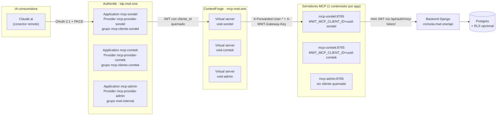

> **Documento histórico.** Refleja el estado del MCP en la fecha en que se escribió
> (los conteos de tools que aparecen abajo —99 / 105 / 125— quedaron obsoletos).
> Hoy el servidor registra **182** herramientas (169 @mcp.tool() únicos + 13 de
> presentación); un admin ve 182, el rol gente_mcp 177 y client_b2b 51.
> Fuente vigente: docs/rol-agente-mcp-propuesta.md. No se reescribe el cuerpo
> para preservar el registro.
# Investigación y Diseño: MCP por Cliente con `cliente_id` Quemado

**Proyecto:** consola_mwt_one (MWT.ONE)
**Documento:** `investigacion_mcp_por_cliente.md`
**Fecha:** 2026-08-14
**Autoría:** Redactor_Arquitecto_MCP (a partir de una auditoría en 6 frentes: Backend, Servidor MCP, Frontend, VPS/Infraestructura, Diseño Authentik e Investigación del protocolo MCP)
**Estado:** Propuesta de arquitectura + auditoría. Todo lo que no cita evidencia (`archivo:línea` o dato de la VPS) está marcado explícitamente como **[PROPUESTA]**.

---

## 1. Resumen ejecutivo

### 1.1 Qué se investigó

Se auditó el monorepo `consola_mwt_one` completo y su despliegue en producción (VPS `187.77.218.102`) con seis frentes de trabajo:

1. **Backend Django** (`backend/`, DRF sobre SQL `managed=False` en `backend/sql/`).
2. **Servidor MCP** (`mcp_server/`, FastMCP streamable-http, 112 tools decoradas + 13 de presentación) y la carpeta `mcp-gateway/`.
3. **Frontend** (`frontend/`, React + Vite, SPA en puerto 3101).
4. **VPS / Infraestructura** (Docker, ContextForge, Authentik 2025.6.3, nginx, estado de contenedores — inspección SSH de solo lectura).
5. **Diseño de identidad Authentik** (providers, applications, scope mappings, policies, revocación).
6. **Investigación externa del protocolo MCP** (spec 2025-06-18 y 2025-11-25, RFC 8707/9728/7591, mejores prácticas de multi-tenancy y de "golden examples" para herramientas consumidas por IAs).

### 1.2 Veredicto del estado actual

> **Hoy el sistema NO cumple el objetivo multi-cliente por aplicación. El aislamiento entre clientes es lógico (filtros ORM por `legal_entity_ids` del usuario), no estructural (una app por cliente). Existe una sola Application en Authentik ("Claude MCP"), un solo servidor virtual en ContextForge ("MWT.ONE"), un solo contenedor MCP y un solo ServiceToken sin `client_ids`. Desactivar un cliente NO corta el acceso a su información.**

Sin embargo, el veredicto no es de reescritura: **la pieza clave del objetivo ya está construida pero sin usar**. El backend ya soporta ServiceTokens con `client_ids` y ya intersecta el scope del usuario con esos `client_ids` al emitir el JWT del MCP (`backend/apps/core/auth_views.py:821-829`), con la invariante documentada *"el JWT emitido NUNCA amplía tenants, solo los restringe"*. Lo que falta es conectar ese claim al enforcement, quemar el `cliente_id` por despliegue, crear las aplicaciones por cliente en Authentik/ContextForge y cerrar 6 brechas de scoping concretas del backend.

### 1.3 Qué se propone (resumen de una línea por decisión)

| # | Decisión | Detalle |
|---|---|---|
| D1 | **Un Provider + Application de Authentik por cliente** (no un provider único con scopes dinámicos) | Es la única opción que cumple literalmente los requisitos 1, 3 y 4 del objetivo. |
| D2 | **`cliente_id` quemado como claim estático** vía Scope Mapping de Authentik + variable de entorno `MWT_MCP_CLIENT_ID` en cada contenedor MCP | Doble quemado: en el token (IdP) y en el despliegue (MCP). |
| D3 | **Un contenedor MCP por cliente** (misma imagen, distinta config) + un servidor virtual por cliente en ContextForge | Aislamiento de proceso y de caché, no solo de query. |
| D4 | **Rechazo de conexión en 3 niveles**: binding de grupo en Authentik (niega `/authorize`), verificación claim-vs-quemado en el MCP (fail-closed), re-verificación en el backend | Ningún usuario llega a ver datos de un cliente al que no pertenece. |
| D5 | **App `mcp-admin` global** con grupo `mwt-internal` y claim `mwt_admin=true`, reutilizando el bypass existente de `BYPASS_ROLES` | Cubre el requisito 2 del objetivo. |
| D6 | **Usuarios multi-empresa**: app por cada empresa del usuario (el usuario es miembro de N grupos) — no se crea una app "multi-cliente" genérica para clientes finales | El membership en Authentik se sincroniza desde `users.mwtuser.legal_entity_ids`. |
| D7 | **Kill-switch en cadena** al desactivar un cliente: hook backend → deshabilitar Application en Authentik → revocar refresh tokens → access tokens de 10 min → backend rechaza por `Cliente.estado` | Corte efectivo total ≤ ~10 minutos. |
| D8 | **Defensa en capas con 5 niveles** (Authentik → ContextForge → MCP → Backend → opcional Postgres RLS) y suite de pruebas adversariales cross-cliente en CI | "A policy you have not attacked is a policy you do not trust". |
| D9 | **Golden Examples** publicados por 3 vías: tool descriptions con few-shot, MCP prompts/resources, y system prompt recomendado | Basado en la guía de Anthropic y la rúbrica académica Purpose/Guidelines/Limitations/Parameters/Examples. |

### 1.4 Riesgos operativos inmediatos (independientes del proyecto multi-cliente)

Estos hallazgos de la auditoría deberían remediarse **antes** o **durante** la Fase 0, porque afectan la producción actual:

- Los patches de ContextForge **v9/v9b/v10 están aplicados en el contenedor activo pero NO en el `entrypoint.sh`** (ni local ni del VPS, que solo aplica v3–v8). Un `docker compose up --force-recreate` del gateway **perdería la propagación de identidad en tools/call** y rompería producción.
- El contenedor `mcp-gateway-authentik-worker` está **unhealthy** (heartbeat Celery congelado ~5.5 días) — las tareas en segundo plano de Authentik probablemente no se procesan.
- El `MWT_MCP_TOKEN` difiere entre el `.env` de consola (`bd79da…`) y el del gateway (`59cc6a…`).
- El contenedor MCP hereda **todos los secretos del `.env`** (claves OpenAI/Anthropic/Kimi, SMTP, MinIO, `AUTHENTIK_API_TOKEN`) aunque solo necesita `MWT_MCP_TOKEN` y `MWT_API_BASE`.
- Un `client_secret` OAuth (`3fed9fd0-c85d-4c53-b46f-5410417ab4ce`) está versionado en claro en `mcp_server/mwt-finanzas-blueprint.yml` — debe rotarse.

---

## 2. Auditoría del estado actual

### 2.1 Backend Django

**Alcance auditado:** `backend/` (Django + DRF, `managed=False` sobre SQL en `backend/sql/`).

#### 2.1.1 Modelo Cliente y ciclo de vida

- `Cliente` vive sobre `clientes.cliente` (`backend/apps/clientes/models.py:18-70`). Tiene **dos mecanismos paralelos y no sincronizados** de "activo":
  - `estado` CharField, default `"ACTIVO"` (`models.py:36`), enum válido `ACTIVO/PAUSADO/BLOQUEADO/INACTIVO` validado en `serializers.py:209-219`; definido en SQL `backend/sql/30_clientes.sql:24`.
  - `is_active` Boolean, default `True` (`models.py:64`; `30_clientes.sql:28`).
- **Subsidiarias:** `parent_id` es CharField(36) **sin FK física** (`models.py:54-57`); regla de máx. 2 niveles en `clean()` (`models.py:322-344`); `get_subsidiaries()` solo activas (`models.py:91-99`); `pool_ids()` consolida crédito padre+subsidiarias (`models.py:101-110`).
- **Soft delete:** `ClienteViewSet.destroy()` (`backend/apps/clientes/views.py:263-269`) hace `is_active=False` al cliente y en cascada lógica a subsidiarias. **Reversible vía PATCH. No toca `estado`, usuarios, tokens ni nada más.**
- **Credit clock** (`clientes/credit_clock.py`, `models.py:468-489`): calcula `bloqueado/bloqueo_reason` por tope de días, pero es **informativo (semáforo)** — ningún middleware/permiso lo usa para cortar requests (MIDDLEWARE en `config/settings.py:113-126` no incluye chequeo de tenant).

#### 2.1.2 Asociación usuario ↔ empresas

- **No existe tabla de membresía tipo UserCliente.** El vínculo es un array en `users.mwtuser.legal_entity_ids` (ArrayField de strings, sin FK) — `backend/apps/users/models.py:43-51`; `legal_entity_id` singular = empresa primaria (retrocompat), sincronizados en `users/serializers.py:105-119`.
- **Flujo de hidratación** (`backend/apps/core/jwt_auth.py:180-321`): `MwtJWTAuthentication.get_user` valida el JWT, busca en `core.users` (por `user_uuid`, líneas 199-217) y luego **joinea por EMAIL case-insensitive** a `users.mwtuser` para obtener `legal_entity_ids` (líneas 248-290). ⚠️ `core.users` (login) y `users.mwtuser` (scope) son tablas con UUIDs distintos — drift de email ⇒ usuario sin scope (warning logueado en `jwt_auth.py:298-307`).
- **`/api/portal/me/`** (`backend/apps/portal/views.py:418-518`): `_all_user_client_ids()` (líneas 284-337) toma los IDs inyectados por la JWT auth; devuelve `empresas[]` filtrando `Cliente.objects.filter(id__in=cids, is_active=True)` (línea 481).

#### 2.1.3 Mecanismo de scoping — estado real

- **Helper central:** `backend/apps/core/scoped_querysets.py` — `filter_by_user_clients()` (línea 86), `filter_by_user_clients_sql()` (124), `scoped_expediente_ids()` (162). Regla: bypass solo `superadmin/admin` (`BYPASS_ROLES`, línea 51) o `is_superuser`; **no-bypass sin empresas → `qs.none()` (fail-closed, líneas 113-116)**. Scope dual con `extra_fields=("operating_company_id",)` para expedientes.
- **Sí scopean:** expedientes (`expedientes/views.py:204,240,261,270,286,293,482,518,984,993,1024,1034,4887` y `scoped_expediente_ids` en 4914-5448), cobros, finance, analytics, notifications, storage, timeline. Portal usa `_resolve_client_ids` con overrides `?empresa_id=`/`X-Portal-Client` validados contra el set del usuario (`portal/views.py:164-281`).
- **Brechas — endpoints/querysets SIN filtro de cliente (posibles fugas):**

  | # | Ubicación | Brecha |
  |---|---|---|
  | B-BE-1 | `transfers/views.py:280-317` | `TransferenciaViewSet` lista y detalla **TODAS las transferencias** sin filtro de cliente (el detalle joinea `clientes.cliente`, línea 1312, exponiendo razón social). Igual en líneas 1723, 1780, 1807. Solo los protege el módulo RBAC `transferencias`. |
  | B-BE-2 | `commercial/views.py:115-126, 351-362, 384-392, 468-473` | `ClientAssignment`, `EarlyPaymentPolicy`, `EarlyPaymentTier`, `PriceListVersion` aceptan `?client_id=` del query string **sin validarlo contra el scope del usuario**. |
  | B-BE-3 | `clientes/views.py:232-237, 251-260, 263-269, 274+` | `retrieve`, `update`, `destroy` y `subsidiarias` de `ClienteViewSet` **NO verifican scope** — un no-staff con `clientes.view` puede leer/editar cualquier cliente por pk. |
  | B-BE-4 | `clientes/views.py:32-54` | `_client_scope_ids` es un helper local cuyo bypass incluye `is_staff`/CEO/manager y el header `X-Viewport-Role` — diverge del `BYPASS_ROLES` canónico de scoped_querysets. |
  | B-BE-5 | `inventario/views.py` | Sin scoping general; solo filtro puntual de artefactos Factura Comercial (1021-1037) y `publicado` para `client_b2b` (1044-1045). |
  | B-BE-6 | `productos` | Catálogo global sin scoping (los `client_prices` por cliente viven en `especificaciones` JSONB; el queryset no filtra por cliente). |

- **RBAC** (`core/permissions.py:209-349`): `required_module` por vista; vistas sin módulo declarado pasan en modo log-only salvo `MWT_RBAC_STRICT=1` (líneas 253-265). Requests con claim `mcp=True` validan contra la matriz exacta de `core.roles.permissions` (líneas 303-325).

#### 2.1.4 ¿Qué pasa hoy al desactivar un cliente?

- `destroy()` solo pone `is_active=False` (cliente + subsidiarias). **No hay signals** — grep de `post_save`/`@receiver` en `backend/apps` arroja **cero resultados**.
- Efecto real: desaparece de `/api/portal/me/` (filtro `is_active=True`, `portal/views.py:481`) — **efecto cosmético**.
- ⚠️ **Los datos siguen accesibles:** el UUID permanece en `users.mwtuser.legal_entity_ids`; ni `_resolve_client_ids` (portal) ni `filter_by_user_clients` verifican `Cliente.is_active`. `mis_ocs`/`mis_expedientes`/`mis_pagos` siguen devolviendo información del cliente desactivado.
- El campo `estado` **no se consulta en ningún path de autorización** — solo validación de enum y semáforo de crédito.
- No hay cascada hacia Authentik (`users/authentik_sync.py` solo actúa en operaciones de `/api/users/`, no de clientes), ni hacia service tokens (`core.service_token`, SQL en `07_core_service_tokens.sql`), ni hacia el MCP.

> **Conclusión del auditor de backend: hoy desactivar/eliminar un cliente NO corta el acceso a su información.**

#### 2.1.5 El punto de anclaje que ya existe

`McpTokenView` (`core/auth_views.py:777-856`) ya intersecta los `legal_entity_ids` del usuario objetivo con los `client_ids` del ServiceToken (líneas 826-829) y emite el claim `legal_entity_ids` en el JWT (línea 837) — **pero `MwtJWTAuthentication.get_user` ignora ese claim** y rehidrata el scope desde `users.mwtuser` por email en cada request (`jwt_auth.py:248-290`). La intersección es hoy decorativa para el enforcement downstream. **Es simultáneamente el bug y el punto de anclaje del diseño objetivo.**

### 2.2 Servidor MCP

**Alcance auditado:** `mcp_server/` (FastMCP, `mwt_mcp/server.py` y módulos) + `mcp-gateway/` local.

#### 2.2.1 Cadena de identidad actual (verificada en código y en producción)

```
Claude/Cursor → ContextForge (mcp.mwt.one, OAuth contra Authentik idp.mwt.one)
  → inyecta X-Forwarded-User-{Email,Id,Name,Roles,Sub} (patches v6/v7)
  → MCP server streamable-http (consola-mwt-one-mcp:8765, SOLO red interna, sin puerto publicado)
  → IdentityPropagationMiddleware guarda headers en contextvar (asgi_middleware.py:21-39)
  → jwt_minter.py mintea JWT de usuario vía POST /api/auth/mcp-token/ firmado con ServiceToken
  → client.py inyecta ese JWT como Bearer en TODAS las llamadas a la API Django (client.py:29-45)
```

- **Token exchange con fail-closed:** si hay identidad propagada y el backend no emite JWT (usuario inactivo/borrado), se levanta `IdentityMintingError` y NUNCA se cae al ServiceToken (`jwt_minter.py:151-165`, `client.py:32-40`). Cache de token 45 min, cache de perfil/permisos 5 min (`jwt_minter.py:41-45`).
- **Sin identidad** (stdio, registro, healthchecks): se usa el ServiceToken estático `MWT_MCP_TOKEN` (`jwt_minter.py:181-183`, `config.py:16`).
- **El filtrado de datos por cliente NO ocurre en el MCP:** ocurre en el backend vía `scoped_querysets.filter_by_user_clients` usando los `legal_entity_ids` del JWT (`scoped_querysets.py:86-115`).
- Capas ya implementadas: RBAC de tools por rol en `list_tools` (`tool_rbac.py:242-279`, fail-closed a lista vacía), redacción de campos sensibles por rol (`redact.py`, `_safe_role` en `server.py:98-125`), auditoría durable de writes y reads sensibles (`server.py:141-166, 250-276`).

#### 2.2.2 ¿Existe hoy filtro por cliente en las tools? — NO

- `expediente_listar` acepta `client` como filtro OPCIONAL libre (`server.py:1027-1041`) — un agente puede pedir cualquier cliente; si el backend scopea bien, no fuga, pero el MCP no añade nada.
- `transferencia_listar`, `pago_listar`, `documento_listar`, `stock_listar`: sin parámetro de cliente siquiera (`server.py:2049-2056, 2331-2337, 1433-1446, 1904-1912`).
- Los `*_obtener(id)` resuelven por UUID/código directo — la protección depende enteramente de que el `retrieve` del backend aplique scope (y la auditoría §2.1.3 confirma que varios NO scopean).
- Única excepción parcial: `expediente_tiempos` en modo phase-stats inyecta `params["client"] = cids[0]` para roles client (`server.py:1751-1756`) — pero solo el PRIMER cliente del usuario.
- La redacción (`redact.py`) es **por rol, no por tenant**: oculta costos/márgenes a `client_b2b`, pero no impide que un usuario con scope amplio (CEO, staff) vea datos de todos los clientes.

#### 2.2.3 Fuga concreta encontrada: caché de enrich GLOBAL

`enrich.py:29-31, 43-63` mantiene `_client_cache` (id→nombre_comercial) como variable global del proceso, cargada con las empresas del PRIMER usuario que la dispare (hasta 500 clientes vía fallback `clientes/` para staff). Un `client_b2b` posterior recibiría `*_name` enriquecidos con nombres de clientes fuera de su scope si el id aparece en su payload. **Fuga menor (solo nombres), pero rompe el aislamiento estricto.** Con un contenedor MCP por cliente (D3), esta fuga desaparece por construcción; aun así debe corregirse con namespacing por usuario.

#### 2.2.4 Hallazgos de seguridad adicionales del MCP

1. **El MCP server NO valida autenticación inbound.** Ni `asgi_middleware.py` ni `server.py` verifican `Authorization` entrante. El MCP **confía ciegamente en `X-Forwarded-User-*` de cualquier cliente que alcance el puerto 8765** en la red Docker. El `auth_value` bearer configurado en el gateway de ContextForge es decorativo: el MCP nunca lo valida. Hoy la única barrera es el aislamiento de red — cualquier contenedor comprometido en `consola-net` puede suplantar a cualquier usuario.
2. **Patches hardcodeados a UN solo server:** v9, v9b y v10 contienen el literal `server_id == "1290625df81d4121a18a66bb164f87f1"` y `gateway_id = "5b0ab59d..."`. Cualquier app MCP por cliente registrada como server nuevo en ContextForge **no heredaría** direct_proxy, propagación de identidad en tools/call, ni el skip de RBAC.
3. **Secreto OAuth en el repo:** `mcp_server/mwt-finanzas-blueprint.yml` contiene `client_secret: 3fed9fd0-c85d-4c53-b46f-5410417ab4ce` en claro. Es el precedente de "una app Authentik por consumidor", pero el secret versionado debe rotarse.
4. **Desactivar un Cliente no apaga su acceso MCP:** `McpTokenView` verifica `is_active` del USUARIO (`auth_views.py:812-816`) pero nunca consulta `clientes.cliente.estado`.
5. **Conexión cross-app no se rechaza, solo se vacía:** si existiera una app del cliente B y entrara un usuario del cliente A, la intersección deja `legal_entity_ids=[]` → `qs.none()` para roles no-bypass (no ve datos, pero la conexión NO se rechaza). Peor: **si entra un admin/superadmin, `BYPASS_ROLES` (`scoped_querysets.py:51`) ignora el scope vacío y ve TODO** — el bypass anula la intersección del ServiceToken.

### 2.3 Frontend

**Alcance auditado:** `frontend/` (React + Vite, SPA servida por nginx en puerto 3101).

- **El frontend NO usa OIDC/Authentik.** Login: formulario usuario+password → `POST /api/auth/login/` contra `core.users` con SHA-256 propio (`frontend/src/pages/Login.jsx:4-8`, `frontend/src/lib/api.js:316`). Un grep por `oidc|authentik|sso|idp.mwt|authorize|callback` sobre `frontend/src` no arroja ninguna coincidencia real. **Implicación:** existen dos directorios de identidad — `core.users` (consola web) y Authentik (gateway MCP) — y el mapeo usuario Authentik ↔ `MwtUser.legal_entity_ids` tendrá que mantenerse (hoy se hace por email, `jwt_auth.py:248-290`).
- **Multi-empresa:** hook `usePortalData(clientId)` (`hooks/usePortalData.js:31-87`); selector de chips visible solo si `empresas.length > 1` (`Portal.jsx:314, 512-546`); estado sin empresas `NoEmpresasState` con el email del usuario para que el admin lo vincule (`Portal.jsx:630-677`).
- **Contexto de empresa al backend — cuatro mecanismos** (precedencia documentada en `ProductCatalogGrid.jsx:93-96`):

  | # | Mecanismo | Naturaleza |
  |---|---|---|
  | 1 | JWT → backend resuelve scope desde `users.mwtuser.legal_entity_ids` | Producción (server-side, confiable) |
  | 2 | Header `X-Portal-Client: <uuid>` (`api.js:1368-1369`) | Dev/impersonation — **modificable por el usuario** |
  | 3 | Query `?client_id=` / `?client=` | Último fallback — modificable |
  | 4 | Header `X-Viewport-Role: ADMIN|CLIENT` (`api.js:227-240`) | Impersonation de rol — modificable |

  El propio código documenta la migración deseada: *"hasta que el JWT claim `portal_client_id` esté en producción"* (`api.js:1364-1366`, `usePortalData.js:15-16`).

- **Lecciones aplicables al diseño MCP:**
  1. El modelo "cliente quemado" elimina de raíz los mecanismos 2-4: `cliente_id` debe ser config de servidor, nunca input de request.
  2. Ya existe precedente de config horneada por build (`VITE_API_BASE`, `api.js:23`) y de deep-links scopeados (`Cronograma.jsx:42-60` acepta `?cliente=<uuid>&exp=<uuid>&aud=CLIENT`).
  3. El rechazo de acceso debe ocurrir **en el handshake de conexión**, no como 403 por-tool.
  4. El logout purga cachés SWR + React Query para no filtrar datos entre usuarios (`AuthContext.jsx:125-128`) — el equivalente MCP es el fail-closed al desactivar un cliente.

### 2.4 VPS / Infraestructura (inspección SSH read-only, 2026-08-14 ~14:10 UTC)

#### 2.4.1 Layout y stacks

- `/opt/` contiene: `consola-mwt-one` (repo git, commit `6b9a12c`, igual al local), `mwt`, `mwt_builder`, `faber_loom`, `mundial_faberloom`, `backups`, `open-design`. **No existe `/opt/mcp-gateway/`** — el gateway vive en `/opt/consola-mwt-one/mcp-gateway/`.
- **Stack consola-mwt-one:** postgres (pgvector pg16, host 5434), redis (6380), django (8100:8000, monta `./backend:/app` como volumen vivo), celery-worker, celery-beat, **mcp-server (8765, SIN puerto publicado al host — solo red interna `consola-net`)**, frontend (`${CONSOLA_FRONTEND_PORT:-3101}:80`).
- **Stack mcp-gateway** (`mcp-gateway/docker-compose.yml`): authentik-postgresql/redis/server/worker (2025.6.3) + contextforge (`ghcr.io/ibm/mcp-context-forge:latest`) con entrypoint custom que aplica 6 patches (`contextforge_patch_v3..v8.py`). Flags clave: `AUTH_REQUIRED=true`, `SSO_ENABLED=true`, `SECURE_COOKIES=true`, `MCPGATEWAY_ADMIN_API_ENABLED=false`, `MCPGATEWAY_DIRECT_PROXY_ENABLED=true`, `SSRF_ALLOWED_NETWORKS=["172.21.0.0/16"]`.

#### 2.4.2 Contenedor `consola-mwt-one-mcp`

- Imagen `consola-mwt-one/mcp-server:latest`, recreada 2026-08-13 13:07 UTC, healthy.
- Env: `MWT_MCP_TRANSPORT=http`, `MWT_API_BASE=http://django:8000/api`, `MWT_MCP_TOKEN=bd79da…`, `MWT_MCP_DOMAIN=` (vacío, monolito), sin `MWT_MCP_READONLY`. **Hereda TODOS los secretos del `.env`** (DJANGO_SECRET_KEY, OPENAI/ANTHROPIC/KIMI keys, AUTHENTIK_API_TOKEN, passwords SMTP/MinIO).
- Código desplegado == código local: `md5sum /app/mwt_mcp/server.py = bc2f993eba2074d0ca8be292d17a345e`, `tool_rbac.py = b68f91edb9867f6e3e1bcb44548f32ca`, idénticos al working tree local.

#### 2.4.3 ContextForge (estado real en `/data/mcp.db`, SQLite 2.3 MB)

- **Gateway:** `5b0ab59d…` "MWT MCP Backend" → `http://consola-mwt-one-mcp:8765/mcp`, STREAMABLEHTTP, `auth_type=bearer`, reachable=1.
- **Server virtual:** `1290625df81d4121a18a66bb164f87f1` "MWT.ONE" — expuesto en `https://mcp.mwt.one/servers/1290625df81d4121a18a66bb164f87f1/mcp`. **Es el ÚNICO server registrado.**
- **SSO provider:** OIDC → issuer `https://idp.mwt.one/application/o/claude-mcp/`, scope `openid profile email`, auto_create_users=1.
- **tools: 99** en catálogo (snapshot del registro inicial; el código actual define 112 tools decoradas + 13 de presentación registradas vía `mcp.add_tool`, `server.py:2536-2545` — el catálogo debe re-registrarse). `registered_oauth_clients` y `oauth_tokens`: vacíos.
- **Los 2 ServiceTokens de producción NO tienen `client_ids`** (`core.service_token_scope`: ambos solo con scope `mcp:token_exchange`, `client_id` NULL). **La intersección de `auth_views.py:827-829` es hoy un no-op.**

#### 2.4.4 Authentik (idp.mwt.one)

- **Applications: SOLO 1** — `Claude MCP` (slug `claude-mcp`), provider OAuth2 confidential, client_id `3b9e3913-a124-4dbb-8fc6-b19d3df3d73c`, redirect_uri estricto `https://claude.ai/api/mcp/auth_callback`.
- **Usuarios: 10**, todos creados 2026-08-06 (sync masiva inicial desde la consola): `akadmin`, `admin`, `alejandro@muitowork.com`, `alvaro@muitowork.com`, `compras2@sondelsa.com`, `logistica2@sondelsa.com`, `jorjecasanova@gmail.com`, `AnonymousUser`, un outpost y el service account.
- **Flows:** solo los 14 default de fábrica; no hay flows custom por cliente.
- El backend Django ya tiene `AUTHENTIK_API_URL=http://authentik-server:9000/api/v3` + `AUTHENTIK_API_TOKEN` en su `.env` (sync de usuarios consola→Authentik vía `backend/apps/users/authentik_sync.py`: crea usuarios, replica password e `is_active`, **pero no gestiona grupos ni membresía usuario↔cliente**).
- nginx (`mwt-nginx`): `mcp.mwt.one → http://contextforge:4444`; `idp.mwt.one → mcp-gateway-authentik-server:9000` (el upstream se llama `pocket_id`, vestigio de la migración Pocket-ID abortada). Rate limiting: 4 zonas. Además, nginx proxifica el `/authorize` del host raíz a Authentik (`fix_nginx_authorize2.py:29-32`) — hoy todo el tráfico OAuth usa el mismo `client_id`.

#### 2.4.5 Contenedores unhealthy / anomalías

| Contenedor | Estado | Diagnóstico |
|---|---|---|
| `mcp-gateway-authentik-worker` | Up 7 días, **unhealthy** | *"Worker hasn't updated heartbeat in threshold"*, delta ~480.000 s (~5.5 días). Proceso vivo pero heartbeat Celery congelado → tareas en segundo plano de Authentik (emails, eventos, sync) probablemente no se procesan. |
| `mwt-celery-worker` / `mwt-celery-beat` | **unhealthy** | Falso negativo: healthcheck usa `pgrep` y la imagen no lo trae (`/bin/sh: 1: pgrep: not found`). |
| `mwt-paperless` | reinicio en bucle | **RestartCount = 112.440** — crash loop crónico. |

Todo lo demás (django, frontend, mcp, contextforge, authentik-server, postgres×N, minio, n8n) healthy.

#### 2.4.6 Brechas de infraestructura contra el objetivo

1. **Brecha total: no existe NADA del modelo multi-app.** Una sola Application en Authentik, un solo server virtual, un solo issuer, una sola URL pública.
2. El aislamiento actual es **solo RBAC lógico**: nada impide estructuralmente que un usuario de Sondel use la app "global".
3. **Sin enforcement de pertenencia en el IdP:** los 10 usuarios de Authentik son globales; no hay grupos por cliente ni política que rechace el login OAuth en la app equivocada.
4. **Desactivación de cliente no revoca acceso MCP** (no hay hook consola→Authentik para clientes).
5. **Desajuste de tokens:** `MWT_MCP_TOKEN` difiere entre `.env` de consola (`bd79da…`) y de gateway (`59cc6a…`). El del contenedor activo es `bd79da…`.
6. **Higiene de secretos:** el contenedor MCP recibe todos los secretos del `.env`; un `docker inspect` los expone.
7. **BD de ContextForge en SQLite** (single-writer, WAL 4 MB) — considerar migración a Postgres antes de multiplicar servers/tenants.

### 2.5 Tabla de brechas priorizadas contra el objetivo multi-cliente

**P0 = bloqueante para el objetivo / riesgo activo. P1 = necesario para la completitud del objetivo. P2 = endurecimiento / mejora.**

| ID | Sev | Brecha | Evidencia | Requisito del objetivo afectado |
|---|---|---|---|---|
| P0-1 | P0 | Patches ContextForge v9/v9b/v10 ausentes del `entrypoint.sh`; un recreate los pierde | `mcp-gateway/patch/entrypoint.sh` (solo v3–v8); grep del contenedor activo confirma v9/v10 presentes | Operación (prerequisito) |
| P0-2 | P0 | MCP no valida autenticación inbound; confía ciegamente en `X-Forwarded-User-*` | grep `asgi_middleware.py`/`server.py`: solo se construyen headers salientes | #1 (aislamiento 100%) |
| P0-3 | P0 | `transfers` sin scoping de cliente (lista/detalle exponen todo) | `transfers/views.py:280-317, 1312, 1723, 1780, 1807` | #1 |
| P0-4 | P0 | `commercial` acepta `?client_id=` sin validar contra scope | `commercial/views.py:115-126, 351-362, 384-392, 468-473` | #1 |
| P0-5 | P0 | `ClienteViewSet.retrieve/update/destroy/subsidiarias` sin scope-check | `clientes/views.py:232-269, 274+` | #1 |
| P0-6 | P0 | Bypass `admin/superadmin` anula la intersección de tenants del ServiceToken | `scoped_querysets.py:51` + `auth_views.py:826-829` | #3 |
| P0-7 | P0 | Desactivar un cliente no corta acceso: ni backend ni MCP ni Authentik consultan `Cliente.estado`/`is_active` en autorización | `clientes/views.py:263-269`; `auth_views.py:812-816`; 0 signals en `backend/apps` | #4 |
| P0-8 | P0 | Conexión cross-app no se rechaza (solo se vacía el scope) | intersección `auth_views.py:826-829` + fail-closed `qs.none()` | #3 |
| P0-9 | P0 | Secreto OAuth versionado en claro en el repo | `mcp_server/mwt-finanzas-blueprint.yml` | Higiene |
| P0-10 | P0 | `MWT_MCP_TOKEN` divergente entre los dos `.env` | `.env` consola `bd79da…` vs `.env` gateway `59cc6a…` | Operación |
| P1-1 | P1 | `get_user` ignora los claims `legal_entity_ids`/`tenant` del JWT del MCP y rehidrata por email | `jwt_auth.py:248-290` | #1, #3 |
| P1-2 | P1 | ServiceTokens de producción sin `client_ids` (intersección no-op) | VPS: `core.service_token_scope` con `client_id` NULL | #1 |
| P1-3 | P1 | Patches v8-v10 hardcodean un solo `server_id`/`gateway_id` | literales `1290625df…`/`5b0ab59d…` en v8:18-19, v9:16-17, v10:39 | #1 |
| P1-4 | P1 | Caché `enrich.py` global entre usuarios (fuga de nombres cross-tenant) | `enrich.py:29-31, 43-63` | #1 |
| P1-5 | P1 | `estado` vs `is_active` divergentes y no sincronizados | `clientes/models.py:36, 64` | #4 |
| P1-6 | P1 | `authentik_sync.py` no gestiona grupos ni mutaciones de `legal_entity_ids` | `backend/apps/users/authentik_sync.py` | #3 |
| P1-7 | P1 | OAuth client-facing global: un solo `client_id` para todos los virtual servers (nginx proxifica `/authorize` raíz) | `fix_nginx_authorize2.py:29-32` | #1, #3 |
| P1-8 | P1 | Contenedor MCP hereda todos los secretos del `.env` | `docker inspect` del contenedor activo | #1 (blast radius) |
| P1-9 | P1 | Catálogo de ContextForge desactualizado (99 tools vs 125 en código) | `mcp.db` vs `server.py` (112 decoradas + 13 `add_tool`) | Golden examples |
| P2-1 | P2 | `_client_scope_ids` diverge del `BYPASS_ROLES` canónico | `clientes/views.py:32-54` | #1 |
| P2-2 | P2 | `inventario` y `productos` sin scoping general | `inventario/views.py`; `productos` | #1 |
| P2-3 | P2 | `authentik-worker` unhealthy (heartbeat 5.5 días); `mwt-paperless` en crash loop (112k restarts) | VPS `docker inspect` | Operación |
| P2-4 | P2 | ContextForge sobre SQLite (single-writer) | `/data/mcp.db` 2.3 MB | Escala |
| P2-5 | P2 | Sin Postgres RLS como última línea de defensa | — | #1 (defensa en profundidad) |
| P2-6 | P2 | Headers `X-Portal-Client`/`X-Viewport-Role` spoofeables en la consola web | `api.js:1368-1369, 227-240` | Higiene consola |

---

## 3. Arquitectura objetivo

### 3.1 Diagrama del flujo



Versión ASCII (flujo end-to-end):

```
 Usuario final ──► Claude.ai ──► https://mcp.mwt.one/servers/<vsid-cliente>/mcp
                                      │ 401 → RFC 9728 → descubre Authentik
                                      ▼
                          Authentik /authorize (app del cliente)
                              login + binding de grupo mcp-cliente-<slug>
                              └── si NO pertenece → DENEGADO (requisito #3) ◄──┐
                                      │ code + PKCE                           │
                                      ▼                                       │
                          Authentik /token → JWT (10 min) con claims:         │
                            sub, email, cliente_id=<UUID QUEMADO>,            │
                            aud=https://mcp.mwt.one/servers/<vsid>/mcp        │
                                      │                                       │
                                      ▼                                       │
                          ContextForge (virtual server vsid)                  │
                            · valida firma JWKS + aud (spec MUST)             │
                            · patch v11: claims.cliente_id == mapeo[vsid] ────┤
                            · direct_proxy + X-Forwarded-User-*               │
                            · X-MWT-Gateway-Key (secreto gateway→MCP)         │
                                      ▼                                       │
                          MCP server del cliente (contenedor dedicado)        │
                            · MWT_MCP_CLIENT_ID quemado por env               │
                            · verifica identidad ∩ cliente quemado ───────────┤
                            · jwt_minter → POST /api/auth/mcp-token/          │
                              (ServiceToken con client_ids=[uuid-cliente])    │
                                      ▼                                       │
                          Backend Django                                      │
                            · get_user: tenant_id del token ∩ scope real      │
                            · verifica Cliente.is_active AND estado=ACTIVO ───┘
                            · filter_by_user_clients (fail-closed qs.none())
                                      ▼
                          Postgres (opcional: RLS app.tenant_id)
```

### 3.2 Modelo de aplicaciones

**[PROPUESTA]** Tres tipos de app MCP:

| Tipo de app | Convención | `cliente_id` | Quién entra | Ejemplo |
|---|---|---|---|---|
| **App por cliente** | `mcp-<slug>` | UUID quemado (1 cliente) | Usuarios cuyo `legal_entity_ids` contiene ese UUID | `mcp-sondel`, `mcp-muitowork`, `mcp-comtek`, `mcp-sonepar-co`, `mcp-imporcomp`, `mcp-procustomer`, `mcp-impco` |
| **App multi-empresa** | *No se crea una app genérica.* Un usuario multi-empresa se conecta a **una app por cada empresa** suya (es miembro de N grupos) | — | — | Un usuario con Sondel + Muito Work configura dos conectores en Claude |
| **App ADMIN global** | `mcp-admin` | Sin restricción (claim `mwt_admin=true`, `cliente_id="*"`) | Solo grupo `mwt-internal` (roles admin/superadmin/ceo/manager) | Soporte y operación MWT |

**Decisión sobre el requisito #2 ("una aplicación puede tener MÁS DE UN cliente"):** el diseño lo soporta de dos formas:

1. **[PROPUESTA] Vía membership:** el usuario multi-empresa pertenece a los grupos `mcp-cliente-<slug>` de cada una de sus empresas y puede autorizar cada app. La "aplicación" sigue teniendo UN solo `cliente_id` quemado — es el *usuario* quien tiene varias apps autorizadas. Esta es la opción recomendada porque mantiene la garantía de encapsulación al 100% por app.
2. **[PROPUESTA] Vía claim multi-valor (solo si el negocio lo exige):** el ServiceToken del contenedor puede llevar `client_ids=[uuid1, uuid2]` (la infraestructura `07_core_service_tokens.sql:68-82` ya soporta N ids) y el Scope Mapping puede emitir `cliente_ids=[...]`. El contenedor operaría en modo "multi-tenant quemado" (`MWT_MCP_CLIENT_IDS` lista). **Se desaconseja para clientes finales** porque rompe la propiedad "ningún dato de un cliente llega a otro" dentro de esa app; reservarla, en todo caso, para grupos corporativos padre+subsidiarias que el negocio trate como una sola entidad (el backend ya consolida crédito padre+subsidiarias vía `pool_ids()`, `clientes/models.py:101-110`).

**App ADMIN:** se representa como **ausencia de `tenant_id` + rol en `BYPASS_ROLES`**, reutilizando el bypass existente de `scoped_querysets.py:51` — el backend ya trata a staff sin `legal_entity_ids` como "ve todos los clientes" (`portal/views.py:259-269`). La app ADMIN lleva además: `aud` propio, access token más corto, ILAC (cuenta solo con acceso al protocolo MCP, no a UI/REST de ContextForge), y audit log que nombre al usuario humano, no a la integración.

### 3.3 Decisión de diseño: Provider+Application por cliente vs. provider único con grupos

Comparación (basada en la investigación de capacidades de Authentik 2025.6.x — Scope Mappings con expresiones Python, bindings de grupo en Application, Admin API ya en uso por `authentik_sync.py`):

| Criterio | A) Provider+App por cliente **(RECOMENDADO)** | B) Un provider + grupos/scopes |
|---|---|---|
| `cliente_id` quemado en la app | ✅ claim estático por provider (no depende del usuario) | ❌ claim dinámico por usuario (no es "quemado") |
| Rechazo en login a app ajena | ✅ nativo: el binding de grupo en la Application niega `/authorize` antes de emitir código | ⚠️ requiere policy de expresión custom + validación downstream |
| Revocación por cliente | ✅ deshabilitar 1 objeto Application + revocar refresh tokens del provider | ❌ quitar grupos a N usuarios, uno por uno |
| Aislamiento de credenciales OAuth | ✅ `client_id` distinto por cliente | ❌ un solo `client_id` para todos (confused deputy) |
| Audience binding (RFC 8707) | ✅ `aud` por virtual server, emitido solo por el provider del cliente | ⚠️ todos comparten `aud` → token del cliente A replayable contra app del cliente B |
| Costo operativo | 4 objetos Authentik por cliente (automatizable vía Admin API — el token ya está en el backend) | mínimo |

**Recomendación: Opción A.** Es la única que cumple literalmente los requisitos del objetivo ("cliente_id QUEMADO", "conexión rechazada", "app deja de funcionar al desactivar"). El costo se absorbe extendiendo `authentik_sync.py` (que ya habla con la Admin API de Authentik desde el backend Django).

### 3.4 Objetos Authentik concretos por cliente (ej. Sondel, slug `sondel`)

**[PROPUESTA]** Cuatro objetos por cliente, nombrados con convención fija:

1. **Grupo** `mcp-cliente-sondel` — miembros = usuarios cuyo `legal_entity_ids` incluye el UUID del cliente. Sincronizado automáticamente desde la consola.
2. **Scope Mapping** (Property Mapping tipo *Scope Mapping*) `mwt-cliente-sondel`, scope `mwt-cliente`, expresión:
   ```python
   # Claim QUEMADO: constante por provider, no depende del usuario
   return {"cliente_id": "<UUID-del-cliente>", "mwt_cliente_slug": "sondel"}
   ```
3. **OAuth2 Provider** `mcp-provider-sondel`:
   - Redirect URI STRICT: `https://claude.ai/api/mcp/auth_callback` (+ las de otros clientes MCP si aplican).
   - Authorization flow: `default-provider-authorization-explicit-consent` (el mismo en uso hoy, `set_authorization_flow.py:6-8`).
   - Scopes: `openid`, `email`, `profile` + scope mapping `mwt-cliente-sondel`.
   - `access_token_validity = minutes=10` (corto: clave para revocación efectiva, ver §5.3).
   - `refresh_token_validity = days=30`.
4. **Application** `mcp-sondel` (slug), provider = `mcp-provider-sondel`, **binding de grupo**: grupo `mcp-cliente-sondel`, `enabled=true`, `order=0`, policy engine `any`.

**App ADMIN:** Application `mcp-admin` + provider `mcp-provider-admin`, grupo `mwt-internal`, scope mapping que devuelve `{"cliente_id": "*", "mwt_admin": true}`.

**Defensa en profundidad opcional en el IdP:** Expression Policy adicional en el provider/flow:
```python
return request.user.ak_groups.filter(name="mcp-cliente-sondel").exists()
```

### 3.5 ContextForge y nginx

- **Un virtual server por app:** `https://mcp.mwt.one/servers/<vsid-sondel>/mcp`, cada uno asociado a un gateway que apunta al contenedor MCP de ese cliente (o al compartido en una fase transitoria — ver §7, Fase 4/5).
- **Generalización de patches (cierra P1-3):** los patches v8/v9/v9b/v10 deben reemplazar el literal de un solo server por una **tabla de mapeo** `vsid → (gateway_id, cliente_id)`, cargada desde la BD de ContextForge o desde un dict por env (`MWT_SERVER_MAP`).
- **OAuth client-facing (cierra P1-7):** hoy ContextForge expone un solo conjunto de endpoints OAuth por host (por eso nginx proxifica el `/authorize` raíz al único provider). Con providers por cliente, el `client_id` correcto debe seleccionarse según el virtual server. **Acción de verificación previa (Fase 3):** comprobar si la versión desplegada de ContextForge soporta OAuth/DCR por virtual server. Si no:
  - **Plan B nginx:** `location = /mcp/<slug>/authorize` que reescribe forzando `client_id=<id-del-provider-del-cliente>` y proxifica a Authentik; equivalente para `/token`. Funciona porque Authentik distingue providers por `client_id` en query/body sobre endpoints compartidos. Requiere metadata por virtual server que apunte `authorization_endpoint` a esa ruta (patch adicional similar a v4/v5).
- **Patch v11 de enforcement (siempre, incluso con Plan A):** en ContextForge, rechazar si `claims["cliente_id"] != mapeo[vsid]` (salvo `mwt_admin=true`). Defensa en profundidad a nivel gateway.
- **`resource` canónico por app:** el RFC 9728 Protected Resource Metadata de cada virtual server debe declarar `resource=https://mcp.mwt.one/servers/<vsid>/mcp` — que es exactamente lo que ContextForge ya genera con server IDs por servidor virtual, y es la URI canónica que el usuario ingresa en Claude (debe coincidir **incluyendo el path**).

### 3.6 Cumplimiento de la especificación MCP (investigación externa)

Hallazgos de la spec que el diseño adopta como requisitos:

1. **Spec vigente: 2025-11-25** (la 2025-06-18 es la anterior; la release candidate actual se convierte en oficial el 28-jul-2026).
2. El MCP server actúa como **OAuth 2.1 Resource Server** y publica **RFC 9728** en `/.well-known/oauth-protected-resource`, respondiendo `401` + `WWW-Authenticate`. Ya implementado vía ContextForge (patches v4/v5 restauran `resource` para Authentik).
3. **RFC 8707 Resource Indicators es MUST para clientes** y **validación de audiencia es MUST para el servidor**: *"MCP servers MUST validate that access tokens were issued specifically for them"*. → Cada app-cliente con URI canónica y `aud` distinto (§3.5).
4. **Token passthrough PROHIBIDO:** el MCP server *"MUST NOT pass through the token it received from the MCP client"* a APIs upstream. → El diseño MWT ya cumple: el token hacia Django es un token **separado** minteado por `/api/auth/mcp-token/` (`jwt_minter.py`), no el JWT de Authentik reenviado.
5. **PKCE S256 obligatorio**; en 2025-11-25 el cliente MUST rechazar flujos si el AS metadata no anuncia `code_challenge_methods_supported`.
6. **Registro de clientes (2025-11-25):** orden de prioridad pre-registro → **CIMD (Client ID Metadata Documents)** → DCR (RFC 7591, ahora solo "backwards compatibility") → prompt al usuario.
7. Tokens **nunca en query string**; `Authorization: Bearer` en cada request; vida corta (SHOULD) y rotación de refresh tokens para clientes públicos (MUST).
8. **Confused deputy (Security Best Practices):** si el gateway usa client ID estático contra el IdP, MUST obtener consentimiento por cada cliente dinámicamente registrado, validar `redirect_uri` con match exacto, y `state` de un solo uso.
9. **Session hijacking:** *"MCP servers MUST NOT use sessions for authentication"*; session IDs ligados al usuario (`<user_id>:<session_id>`).
10. **Scope minimization:** scopes mínimos iniciales, elevación incremental vía challenges, y **nunca tratar los scopes del token como suficientes sin lógica de autorización server-side** (→ la triple verificación de §4).
11. **Claude.ai web solo habla OAuth 2.1** en conectores remotos (authorization code + PKCE, DCR/CIMD, bearer). *"There is nowhere to paste a static key."* El callback fijo es `https://claude.ai/api/mcp/auth_callback`. Al desconectar un conector, Anthropic borra sus tokens pero los del IdP siguen vivos → **la revocación en Authentik es obligatoria** para el kill-switch (§5.3).
12. Riesgo conocido: regresión de token-binding en conectores nuevos de claude.ai (jun-2026, issue anthropics/claude-ai-mcp#430) — monitorear al onboardear clientes.

---

## 4. Protocolo de comunicación y validación end-to-end

### 4.1 Flujo OAuth 2.1 completo (Claude.ai como consumidor)

1. El usuario registra en Claude el conector `https://mcp.mwt.one/servers/<vsid-cliente>/mcp`.
2. Claude hace `GET` sin token → recibe `401` + `WWW-Authenticate` → `GET /.well-known/oauth-protected-resource` (RFC 9728; incluye `resource` y `authorization_servers`).
3. `GET /.well-known/oauth-authorization-server` → descubre `authorization_endpoint`, `token_endpoint`, `registration_endpoint`.
4. Registro del cliente (pre-registro, CIMD o DCR según soporte) con redirect `https://claude.ai/api/mcp/auth_callback` → obtiene `client_id`. **Con N providers, esta es la pieza que el Plan B nginx (§3.5) debe mapear al provider del cliente correcto.**
5. `GET /authorize?response_type=code&client_id=<cliente>&redirect_uri=...&scope=openid email profile mwt-cliente&code_challenge=...(S256)&resource=https://mcp.mwt.one/servers/<vsid>/mcp` → nginx → Authentik `/application/o/authorize/`.
6. Authentik: identification + password → **binding de grupo `mcp-cliente-<slug>`** (deniega si el usuario no pertenece → requisito #3 cumplido en la primera capa) → consent explícito → emite `code`.
7. `POST /token` (code + `code_verifier`) → access token JWT (~10 min) con claims `email`, `sub`, **`cliente_id`** (quemado por scope mapping), `aud` = URI del virtual server + refresh token (30 días, con rotación).
8. Llamadas MCP: `Authorization: Bearer <jwt>` → ContextForge valida firma JWKS + `aud` → extrae email (fallback userinfo, patch v3) → **patch v11 valida `cliente_id` vs virtual server** → direct_proxy con `X-Forwarded-User-*` + `X-MWT-Gateway-Key` → `mcp_server` del cliente.
9. `jwt_minter` canjea la identidad por JWT backend vía `POST /api/auth/mcp-token/` firmado con el ServiceToken del contenedor (que lleva `client_ids=[uuid-cliente]`) → el backend intersecta, verifica estado del cliente y emite JWT de usuario (1 h) → `client.py` lo usa como Bearer contra la API Django.
10. Expira el access token → `POST /token` `grant_type=refresh_token` → nuevo par de tokens. Si el cliente fue desactivado: refresh revocado → el usuario es redirigido a `/authorize` → app deshabilitada o sin binding → **denegado**.

### 4.2 Claims del token (dos niveles de JWT)

**Nivel 1 — JWT de Authentik (IA ↔ ContextForge), ~10 min:**

```json
{
  "iss": "https://idp.mwt.one/application/o/mcp-provider-sondel/",
  "sub": "f3a1...",
  "aud": "https://mcp.mwt.one/servers/<vsid-sondel>/mcp",
  "exp": 1755189000,
  "iat": 1755188400,
  "email": "compras2@sondelsa.com",
  "name": "Compras Sondel",
  "cliente_id": "8f4e2c1a-....-sondel-uuid",
  "mwt_cliente_slug": "sondel",
  "scope": "openid email profile mwt-cliente"
}
```

- `cliente_id` es **estático por provider** (quemado por el scope mapping §3.4): dos usuarios distintos de Sondel reciben el mismo `cliente_id`. Es **pista de enrutamiento y reclamo de pertenencia**, no la autorización final (la autorización final la re-deriva el backend desde la DB).
- `aud` es distinto por app: un token del cliente A no es replayable contra la app del cliente B (RFC 8707 + patch v11).

**Nivel 2 — JWT backend MWT (MCP ↔ Django), 1 h, emitido por `McpTokenView`:**

```json
{
  "user_uuid": "...",
  "email": "compras2@sondelsa.com",
  "role": "client_b2b",
  "modules": ["portal", "expedientes", "pagos"],
  "legal_entity_ids": ["8f4e2c1a-....-sondel-uuid"],
  "tenant_id": "8f4e2c1a-....-sondel-uuid",
  "mcp": true,
  "exp": 1755192000
}
```

- `tenant_id` **[PROPUESTA]** = cliente quemado de la app, validado en el mint contra `legal_entity_ids` del usuario en DB y contra los `client_ids` del ServiceToken.
- `legal_entity_ids` del JWT del MCP = **intersección** (usuario ∩ ServiceToken) — la lógica ya existe en `auth_views.py:826-829`; el cambio es que `get_user` la respete (cierra P1-1).

### 4.3 Triple verificación (dónde se comprueba qué)

| # | Capa | Verificación | Falla → |
|---|---|---|---|
| V1 | Authentik | ¿El usuario pertenece al grupo de la app? (binding de grupo en Application) | `/authorize` denegado: "You don't have access to this application" |
| V2 | ContextForge | Firma JWKS, `exp`, `aud` == URI del virtual server; patch v11: `cliente_id` == mapeo[vsid] | 401/403 |
| V3 | MCP server | `MWT_MCP_CLIENT_ID` definido ⇒ identidad propagada ∩ quemado ≠ ∅; guard anti-bypass (rol admin/superadmin rechazado o degradado en apps de cliente) | `IdentityMintingError` → tools 401 / list_tools vacío (fail-closed ya existente en `tool_rbac.py:255-263`, `client.py:32-40`) |
| V4 | Backend | `get_user`: `tenant_id` ∩ scope real en DB; `Cliente.is_active=True AND estado='ACTIVO'` en el mismo lookup | `AuthenticationFailed` |
| V5 | Backend datos | `filter_by_user_clients` lee `request.auth` (claims del token) antes que `user.legal_entity_ids` | `qs.none()` |

### 4.4 Revocación e introspección

- **Access tokens ya emitidos** son JWT autofirmados que ContextForge valida offline vía JWKS — siguen vivos hasta su `exp`. Por eso `access_token_validity = minutes=10` es **obligatorio**: la ventana residual de un cliente desactivado es ≤ 10 min. (Alternativa más fuerte, con costo de latencia por request: habilitar introspection en ContextForge si la versión lo soporta.)
- **Refresh tokens** se revocan por provider vía Admin API: `DELETE /api/v3/oauth2/refresh_tokens/<id>/` (listar con `?provider=<pk>`).
- **Capa backend (red de seguridad final):** aunque un access token sobreviva, el siguiente tool call gatilla minting en `/auth/mcp-token/`; con el chequeo de `Cliente.estado` (P0-7) el backend rechaza. Con cache de perfil de 5 min (`_PROFILE_TTL_SECONDS`, `jwt_minter.py:45`) y cache de token de 45 min, la revocación efectiva total es **≤ ~10 min** una vez implementado el chequeo de estado en el mint (el JWT de usuario cacheado de 45 min debe además acotarse: **[PROPUESTA]** invalidar el cache de `jwt_minter` cuando el mint falla y reducir el TTL del cache de token a 10 min en apps por cliente).

---

## 5. Garantías anti-fuga (defensa en capas)

### 5.1 Tabla de capas

| Capa | Componente | Mecanismo | Qué garantiza | Estado |
|---|---|---|---|---|
| L0 | Red Docker | MCP sin puerto publicado; solo red `consola-net`; `SSRF_ALLOWED_NETWORKS=["172.21.0.0/16"]` | El MCP no es alcanzable desde Internet | ✅ Existe |
| L1 | Authentik | Binding de grupo `mcp-cliente-<slug>` en la Application; claim `cliente_id` estático por provider; `aud` por app | Nadie obtiene token para una app de un cliente al que no pertenece | ❌ Falta (P1-6) |
| L2 | ContextForge | Validación JWKS + `aud`; patch v11 claim↔vsid; rate limiting nginx (auth 3r/s) | Un token de la app A no sirve en la app B; confusión de virtual servers rechazada | ⚠️ Parcial (v11 falta; P1-3, P1-7) |
| L3 | MCP server | Secreto gateway→MCP (`X-MWT-Gateway-Key`) antes de honrar `X-Forwarded-User-*`; `MWT_MCP_CLIENT_ID` quemado + doble verificación en `jwt_minter`; guard anti-bypass | Suplantación desde otro contenedor rechazada; usuario sin pertenencia rechazado aunque el IdP falle | ❌ Falta (P0-2) |
| L4 | Backend Django | `tenant_id` del token ∩ scope real; verificación `Cliente.is_active AND estado='ACTIVO'`; `filter_by_user_clients` leyendo claims; cierre de las 6 brechas de scoping (§2.1.3) | Aunque todas las capas superiores fallen, el dato no cruza | ⚠️ Parcial (P0-3..P0-8, P1-1) |
| L5 | Postgres RLS (opcional, P2-5) | `ENABLE + FORCE ROW LEVEL SECURITY`; policy `USING (tenant_id = current_setting('app.tenant_id')::uuid)` + `WITH CHECK`; `SET LOCAL` por transacción; rol app bajo RLS y rol `BYPASSRLS` solo para mantenimiento | Garantía a nivel motor: aunque el ORM falle, el dato no cruza | ❌ Futuro |

**Por qué L5 importa (consenso de la investigación externa):** el filtro a nivel aplicación es necesario pero no suficiente — *"its failure mode is a query that works but returns wrong data, not a query that errors"*. RLS mueve la garantía al motor. Trampas documentadas: PgBouncer en transaction mode resetea variables de sesión (usar `SET LOCAL`); RLS falla en silencio (0 filas, no error); superusuarios y table owners bypassean salvo `FORCE`; CDC/backups pueden bypassear.

### 5.2 Matriz de escenarios de ataque/error

| Escenario | L1 IdP | L2 Gateway | L3 MCP | L4 Backend | Veredicto |
|---|---|---|---|---|---|
| Usuario de Sondel intenta autorizar la app de Comtek | **DENEGADO** (no está en `mcp-cliente-comtek`) | — | — | — | Detenido en L1 (requisito #3) |
| Token de la app Sondel replayed contra vsid Comtek | — | **DENEGADO** (`aud` no coincide + patch v11) | — | — | Detenido en L2 |
| Contenedor comprometido en `consola-net` inyecta `X-Forwarded-User-Email: ceo@muitowork.com` | — | — | **DENEGADO** (falta `X-MWT-Gateway-Key`; cierra P0-2) | — | Detenido en L3 |
| IdP emite token con `cliente_id` falso o sin claim | — | v11 rechaza si ≠ mapeo | **DENEGADO** (claim ∩ quemado = ∅) | **DENEGADO** (tenant ∩ scope real = ∅) | Detenido en L3/L4 |
| Usuario con rol admin entra a la app de un cliente | (permitido si el negocio lo decide) | — | **DENEGADO/DEGRADADO** por guard anti-bypass (cierra P0-6) | backend fuerza `tenant_id` | Detenido en L3 |
| Backend caído durante el mint | — | — | **Fail-closed** (`IdentityMintingError`, nunca cae a ServiceToken — `jwt_minter.py:151-165`) | — | Detenido en L3 |
| Usuario pide `expediente_listar?client=<uuid-ajeno>` | — | — | (sin efecto: el backend ignora el filtro fuera de scope) | **`qs.none()`** o intersección vacía | Detenido en L4 |
| Tool `transferencia_obtener(<uuid-ajeno>)` | — | — | — | **403/vacío** tras cerrar P0-3 | Detenido en L4 |
| Bug ORM: un queryset nuevo olvida `filter_by_user_clients` | — | — | — | (sin protección hoy) | **L5 RLS** lo detendría (P2-5) |
| Cliente desactivado con tokens vivos | app deshabilitada (nuevos logins mueren) | tokens vivos ≤10 min | mint rechaza por `Cliente.estado` | **`AuthenticationFailed`** | Cortado ≤ ~10 min (requisito #4) |

### 5.3 Cadena de corte al desactivar/eliminar un cliente

**[PROPUESTA]** Hook explícito en backend (no hay signals hoy — 0 resultados de `post_save`/`@receiver` en `backend/apps`; hacerlo en la vista/servicio de `ClienteViewSet.destroy` y en cualquier mutación de `estado`):

```
Cliente.estado → INACTIVO/BLOQUEADO  (o destroy() → is_active=False)
   │
   ├─ 1. Backend: PATCH Authentik Admin API → deshabilitar Application mcp-<slug>
   │      (efecto inmediato sobre NUEVAS autorizaciones)
   ├─ 2. Backend: revocar refresh tokens del provider mcp-provider-<slug>
   │      (DELETE /api/v3/oauth2/refresh_tokens/<id>/ por cada token del provider)
   ├─ 3. Access tokens vivos: mueren por exp ≤ 10 min (access_token_validity=minutes=10)
   ├─ 4. Backend: remover el UUID del cliente de users.mwtuser.legal_entity_ids
   │      de todos los usuarios afectados
   ├─ 5. Backend: revocar ServiceToken del contenedor MCP del cliente
   │      (core.service_token, 07_core_service_tokens.sql)
   ├─ 6. ContextForge: deshabilitar el virtual server vsid-<slug>
   └─ 7. Docker: parar/retirar el contenedor mcp-<slug> (Fase 5)
```

**Eliminar cliente** = lo anterior + borrar Application, Provider, Scope Mapping y grupo en Authentik; retirar el virtual server y el contenedor; conservar datos según política de retención (el soft delete actual es reversible vía PATCH — decisión de negocio).

**Nota:** hoy el sync consola→Authentik (`authentik_sync.py`) replica `is_active` del **usuario**, pero no hay nada para **clientes** (P0-7). La Fase 3 y el runbook (Fase 8) cubren ambos.

---

## 6. Golden Examples para las IAs

### 6.1 Principios (basados en la investigación externa)

1. **Tool descriptions prompt-engineered** (guía de Anthropic *Writing tools for agents*): la description es el principal mecanismo de control de calidad; el caso documentado del web search de Claude añadiendo "2025" espurio se arregló mejorando la description, no el código.
2. **Rúbrica académica** (arXiv 2602.14878): toda description debe tener componentes distinguibles — **Purpose, Guidelines, Limitations, Parameter Explanation, Examples**. Purpose+Guidelines+Limitations+ParameterExplanation iguala o supera a descriptions totalmente aumentadas.
3. **Identificadores en lenguaje natural, no UUIDs crudos** en las respuestas: *"merely resolving arbitrary UUIDs to meaningful language significantly improves precision and reduces hallucinations"*. Las tools MWT ya enriquecen nombres (`enrich.py`); mantenerlo.
4. **Output schemas con honestidad:** si se declara `outputSchema`, el `structuredContent` DEBE cumplirlo o los clientes rechazan con `-32602` (caso real WooCommerce: `date-time` sin timezone, `null` no declarado, strings vacíos vs `format: uri`). Regla: **el schema refleja la respuesta real incluyendo nullability, o no se declara**.
5. **Few-shot en descriptions** cuando el mapeo input→output es matizado o hay formatos especiales no capturables por tipos (prefijos `PO-`, fechas de fabricación, tallas).
6. **Errores estructurados y accionables** (retry-with-error-feedback): el mensaje de error debe permitir al agente corregir sin adivinar.
7. **Evaluación sistemática:** tasks de evaluación realistas multi-tool, corridas programáticas, con análisis de transcripts — con 112+ tools es prácticamente obligatorio.

### 6.2 Convenciones de respuesta MWT (propuesta de normalización)

**[PROPUESTA]** Todas las tools del MCP siguen estas convenciones (la mayoría ya las siguen de facto):

- **Monedas:** los montos viajan como números en USD salvo indicación explícita (`*_crc` para colones). La IA SIEMPRE muestra el símbolo/código de moneda y usa separadores de miles: `$12,450.00 USD`, `₡6,284,750 CRC`. Nunca inventa un tipo de cambio: lo obtiene de `tipo_cambio`.
- **Tipo de cambio:** semántica confirmada del backend — `rate` = unidades de moneda local por 1 USD (fallback interno del servidor: **505.0 ₡/USD** si la fuente externa falla; la fuente primaria es open.er-api.com como fallback INTERNO, no dependencia del MCP).
- **Fechas:** ISO 8601 (`2026-08-14`) en JSON; la IA las presenta en español legible ("14 de agosto de 2026") y aclara la zona si es relevante.
- **Códigos visibles por rol:** un `client_b2b` ve códigos de presentación (OC/SAP) pero NO IDs internos ni costos/márgenes (`redact.py`); la IA no debe "adivinar" datos ausentes ni mencionar que fueron ocultados.
- **Errores:** shape `{ "error": true, "code": "<CODIGO>", "detail": "<mensaje accionable en español>" }`.

### 6.3 Ejemplos dorados

> Nota de método: los payloads son **ejemplos ilustrativos construidos sobre los shapes reales** de las tools (verificados en `server.py`, `redact.py`, tests en `mcp_server/tests/`) y deben validarse contra datos reales en Fase 6. Los UUID se abrevian como `8f4e…sondel`.

---

**Ejemplo GE-01 — Consulta de expedientes exitosa (rol client_b2b, app de Sondel)**

Request de la IA:
```json
{"tool": "expediente_listar", "arguments": {"estado": "EN_TRANSITO", "limit": 10}}
```

Respuesta de la tool:
```json
{
  "count": 2,
  "results": [
    {
      "id": "exp-7c21…",
      "codigo": "EXP-2488-2026",
      "cliente_nombre": "Sondel S.A.",
      "estado": "EN_TRANSITO",
      "incoterm": "FOB",
      "puerto_destino": "Caldera, CR",
      "fecha_eta": "2026-09-02",
      "total_usd": 48230.50
    },
    {
      "id": "exp-91ab…",
      "codigo": "EXP-2501-2026",
      "cliente_nombre": "Sondel S.A.",
      "estado": "EN_TRANSITO",
      "incoterm": "CIF",
      "puerto_destino": "Caldera, CR",
      "fecha_eta": "2026-09-15",
      "total_usd": 12875.00
    }
  ]
}
```

Cómo la IA debería presentarlo:
> "Tienes **2 expedientes en tránsito**: el **EXP-2488-2026** (FOB, ETA 2 de septiembre de 2026, Puerto Caldera) por **$48,230.50 USD**, y el **EXP-2501-2026** (CIF, ETA 15 de septiembre) por **$12,875.00 USD**. ¿Quieres el detalle de alguno?"

Regla de comportamiento: resumir en tabla o lista corta, ofrecer el siguiente paso natural (`expediente_obtener`). Nunca listar UUIDs al usuario.

---

**Ejemplo GE-02 — Detalle de expediente con líneas y costos (rol interno MWT en app admin)**

Request:
```json
{"tool": "expediente_obtener", "arguments": {"id": "EXP-2488-2026"}}
```

Respuesta (rol admin — ve ambos precios):
```json
{
  "id": "exp-7c21…",
  "codigo": "EXP-2488-2026",
  "cliente_nombre": "Sondel S.A.",
  "estado": "EN_TRANSITO",
  "lineas": [
    {
      "producto_nombre": "Bota industrial Marluvas 60B29",
      "sku": "60B29-CPAP-SRV",
      "talla": "42",
      "cantidad": 300,
      "unit_price_client": 18.90,
      "unit_price_mwt": 12.40
    }
  ],
  "shipping": {"contenedor": "MSKU-482111-3", "eta": "2026-09-02"},
  "totales": {"total_cliente_usd": 48230.50, "total_mwt_usd": 31610.00}
}
```

Presentación:
> "El **EXP-2488-2026** de Sondel S.A. está en tránsito (contenedor MSKU-482111-3, ETA 2 de septiembre). Lleva 300 pares de Bota industrial Marluvas 60B29 talla 42. Total cliente: **$48,230.50 USD**; costo MWT: **$31,610.00 USD**."

Regla: para `client_b2b` los campos `unit_price_mwt`, `total_mwt_usd` y costos internos **no aparecen** (redactados como `***` por `redact.py`); la IA no debe referenciar su ausencia.

---

**Ejemplo GE-03 — Consulta de productos / catálogo**

Request:
```json
{"tool": "producto_buscar", "arguments": {"q": "bota alta dielectrica"}}
```

Respuesta:
```json
{
  "count": 1,
  "results": [
    {
      "id": "prod-55f0…",
      "sku": "60B29-CPAP-SRV",
      "nombre": "Bota industrial dieléctrica Marluvas 60B29",
      "marca": "Marluvas",
      "ncm": "6403.40",
      "precio_cliente_usd": 18.90
    }
  ]
}
```

Presentación:
> "Encontré 1 producto: **Bota industrial dieléctrica Marluvas 60B29** (SKU `60B29-CPAP-SRV`, NCM 6403.40), precio **$18.90 USD** por par. ¿Quieres la ficha técnica o tus expedientes con este producto?"

Regla: `producto_buscar` resuelve por SKU, nombre, características (especificaciones como `tipo_calzado`, suela) y alias comerciales (tests `test_ola38_producto_buscar.py`). Si el cliente pregunta "¿cuánto me cuesta la bota 60B29?", usar `producto_precio_cliente` para el precio contractual del cliente autenticado, no el precio de lista.

---

**Ejemplo GE-04 — Estado de crédito del cliente**

Request:
```json
{"tool": "cliente_kpis_pool", "arguments": {}}
```

Respuesta:
```json
{
  "cliente": "Sondel S.A.",
  "credito_limite_usd": 150000.00,
  "credito_usado_usd": 96540.25,
  "credito_disponible_usd": 53459.75,
  "credit_days": 60,
  "bloqueado": false,
  "pool_incluye_subsidiarias": true
}
```

Presentación:
> "Sondel tiene un crédito de **$150,000 USD** (a 60 días), de los cuales hay **$53,459.75 USD disponibles** (usado: $96,540.25). La línea no está bloqueada e incluye las subsidiarias en el mismo pool."

Regla: `pool_ids()` consolida crédito padre+subsidiarias (`clientes/models.py:101-110`); el campo `bloqueado` del credit clock es un semáforo informativo (§2.1.1) — si `bloqueado=true`, la IA debe explicar el `bloqueo_reason` (tope de días de crédito) y sugerir contactar a MWT, sin prometer desbloqueo.

---

**Ejemplo GE-05 — Proforma generada**

Request:
```json
{"tool": "proforma_generar", "arguments": {"expediente_id": "exp-7c21…"}}
```

Respuesta:
```json
{
  "proforma": "PF-2488-2026",
  "expediente": "EXP-2488-2026",
  "cliente_nombre": "Sondel S.A.",
  "total_usd": 48230.50,
  "url_documento": "https://consola.mwt.one/documentos/pf-2488-2026.pdf",
  "audience_usada": "CLIENT"
}
```

Presentación:
> "Generé la proforma **PF-2488-2026** por **$48,230.50 USD**. Puedes descargarla aquí: [PDF]. ¿Quieres que la envíe también por correo o que genere el HTML para revisión?"

Regla: `proforma_generar` acepta `audience` (`CLIENT`, `ADMIN_ONLY`, y el servidor también acepta `MWT_INTERNAL`). Para un cliente final la IA debe usar siempre la versión CLIENT (sin costos internos). Confirmar el expediente correcto ANTES de generar si el usuario mencionó varios.

---

**Ejemplo GE-06 — Error: usuario no pertenece al cliente de esta app (requisito #3)**

Escenario: un usuario de Muito Work intenta usar la app `mcp-sondel`.

- **En Authentik (capa L1):** el authorization flow se deniega antes de emitir código — la IA ni siquiera conecta; Claude muestra el fallo de autorización del conector.
- **Si el token existiera (defensa en profundidad, capas L2–L4):**

Respuesta de cualquier tool:
```json
{
  "error": true,
  "code": "TENANT_MISMATCH",
  "detail": "Esta aplicación MCP está restringida a Sondel S.A. y tu usuario no está asociado a esa empresa. Si crees que es un error, contacta a soporte de MWT (soporte@mwt.one) indicando tu correo."
}
```

Presentación:
> "No puedo consultar esta aplicación: está restringida a Sondel S.A. y tu cuenta no está asociada a esa empresa. Si deberías tener acceso, escribe a soporte@mwt.one con tu correo para que te vinculen."

Regla: la IA **no reintenta**, no prueba otros parámetros ni otras tools, y no especula sobre los datos del cliente ajeno. Un `TENANT_MISMATCH` es terminal para la sesión.

---

**Ejemplo GE-07 — Error: cliente desactivado (requisito #4)**

Escenario: Sondel fue desactivado; quedan access tokens vivos (ventana ≤10 min) o el usuario reintenta.

Respuesta del mint/tool:
```json
{
  "error": true,
  "code": "CLIENTE_INACTIVO",
  "detail": "La cuenta de Sondel S.A. está desactivada. Las operaciones están suspendidas hasta que MWT la reactive. Contacta a tu ejecutivo de cuenta."
}
```

Presentación:
> "La cuenta de Sondel S.A. está temporalmente desactivada, así que no puedo consultar sus expedientes ni generar documentos. Por favor contacta a tu ejecutivo de cuenta en MWT para reactivarla."

Regla: comportamiento idéntico para `estado=BLOQUEADO` (la IA puede mencionar motivo si el backend lo incluye, p. ej. tope de crédito) y para eliminación. La IA no ofrece workarounds.

---

**Ejemplo GE-08 — Error: parámetros inválidos**

Request:
```json
{"tool": "expediente_obtener", "arguments": {"id": "EXP2488"}}
```

Respuesta:
```json
{
  "error": true,
  "code": "PARAMETRO_INVALIDO",
  "detail": "El parámetro 'id' debe ser un UUID o un código con formato EXP-<número>-<año> (ej. EXP-2488-2026). Recibido: 'EXP2488'."
}
```

Presentación:
> "El código 'EXP2488' no tiene el formato esperado. ¿Te refieres al **EXP-2488-2026**? Si es así, lo consulto de inmediato."

Regla: el `detail` incluye el formato esperado y el valor recibido (retry-with-error-feedback). La IA corrige y reintenta UNA vez; si vuelve a fallar, pregunta al usuario. Patrón análogo para fechas (`fecha_fabricacion` en `sap_confirmar` es `YYYY-MM-DD`, no "ayer").

---

**Ejemplo GE-09 — Respuesta vacía sin resultados**

Request:
```json
{"tool": "expediente_buscar", "arguments": {"q": "PO-999999"}}
```

Respuesta:
```json
{
  "count": 0,
  "results": [],
  "detail": "Sin expedientes que coincidan con 'PO-999999' en el alcance de Sondel S.A."
}
```

Presentación:
> "No encontré ningún expediente con la referencia PO-999999. Puedo buscar por otro número de OC, por producto o por rango de fechas, o listarte los expedientes activos."

Regla: una respuesta vacía **no es un error** — la IA lo comunica con naturalidad y ofrece alternativas de búsqueda. Jamás inventa un expediente para "rellenar" la respuesta.

---

**Ejemplo GE-10 — Acción destructiva que requiere confirmación**

Request candidato (la IA NO debe ejecutarlo sin confirmar):
```json
{"tool": "expediente_eliminar", "arguments": {"id": "exp-7c21…"}}
```

Comportamiento dorado de la IA (antes de llamar):
> "Vas a **eliminar el expediente EXP-2488-2026** de Sondel (300 pares de bota Marluvas 60B29, $48,230.50 USD). Esta acción no se puede deshacer. ¿Confirmas que quieres eliminarlo? Responde 'sí, eliminar' para proceder."

Respuesta si el usuario confirma:
```json
{"ok": true, "id": "exp-7c21…", "detail": "Expediente EXP-2488-2026 eliminado."}
```

Regla: las tools de escritura destructiva (`expediente_eliminar`, `documento_eliminar`, `transfer_costo_eliminar`, `transferencia_cancelar`, `pago_rechazar`, `expediente_desfusionar`) requieren **confirmación explícita del usuario en el mismo turno**, con un resumen de lo que se va a afectar. La IA nunca confirma "en nombre del usuario" ni encadena una destructiva tras una consulta sin fricción. Estas tools además quedan en el registro de auditoría (`server.py:141-166`).

---

**Ejemplo GE-11 — Tipo de cambio USD/CRC y formato de monedas**

Request:
```json
{"tool": "tipo_cambio", "arguments": {"moneda": "CRC"}}
```

Respuesta:
```json
{
  "moneda": "CRC",
  "rate": 512.35,
  "base": "USD",
  "fuente": "open.er-api.com",
  "fecha": "2026-08-14",
  "fallback": false
}
```

Presentación:
> "El tipo de cambio actual es **₡512.35 por $1 USD** (14 de agosto de 2026). El total del expediente EXP-2488-2026 ($48,230.50 USD) equivale a aproximadamente **₡24,708,486** al tipo de cambio de hoy."

Regla: `rate` = colones por 1 USD (semántica confirmada). Si la respuesta llega con `"fallback": true`, la IA debe advertir que es un valor de referencia fijo (505.0 ₡/USD, fallback interno del servidor) y sugerir verificar el tipo de cambio oficial del BCCR para operaciones reales. Nunca mezclar monedas sin conversión explícita.

---

**Ejemplo GE-12 — Listado de transferencias y liquidación**

Request:
```json
{"tool": "transferencia_listar", "arguments": {"estado": "EN_TRANSITO"}}
```

Respuesta:
```json
{
  "count": 1,
  "results": [
    {
      "id": "tr-33dd…",
      "codigo": "TR-0142",
      "origen": "Bodega Zona Franca, CR",
      "destino": "Sondel S.A. — San José",
      "estado": "EN_TRANSITO",
      "fecha_despacho": "2026-08-10"
    }
  ]
}
```

Request de liquidación:
```json
{"tool": "transfer_liquidacion_preview", "arguments": {"transferencia_id": "tr-33dd…"}}
```

Respuesta:
```json
{
  "transferencia": "TR-0142",
  "metodo": "BY_VALUE",
  "fob_total_usd": 31610.00,
  "extra_costs_total_usd": 4275.30,
  "extra_costs_iva_usd": 0.00,
  "landed_cost_total_usd": 35885.30,
  "desglose": [
    {"kind": "FLETE", "monto_usd": 2100.00, "capitalizable": true},
    {"kind": "SEGURO", "monto_usd": 640.30, "capitalizable": true},
    {"kind": "DAI", "monto_usd": 1535.00, "capitalizable": true, "scope": "NCM 6403.40"}
  ]
}
```

Presentación:
> "La transferencia **TR-0142** (Zona Franca → Sondel San José, despachada el 10 de agosto) está en tránsito. Su liquidación preliminar: FOB **$31,610.00 USD** + costos capitalizables **$4,275.30 USD** (flete $2,100.00, seguro $640.30, DAI por NCM $1,535.00) = landed cost **$35,885.30 USD**."

Regla: el motor de liquidación **excluye el IVA del landed cost** (los costos `IVA` se reportan aparte, solo informativos, en `extra_costs_iva_usd`) y prorratea cada costo según su `scope_json` (líneas específicas, expedientes, o toda la transferencia; DAI por NCM). La IA debe presentar IVA y costos capitalizables **por separado** y nunca sumar el IVA al costo del producto.

---

**Ejemplo GE-13 — RBAC: tool no disponible para el rol**

Escenario: un `client_b2b` (o la IA actuando por él) intenta `mwt_diag_scope` (solo CEO).

Respuesta:
```json
{
  "error": true,
  "code": "TOOL_NO_DISPONIBLE",
  "detail": "Esta herramienta no está disponible para tu perfil."
}
```

Presentación:
> "No tengo acceso a esa función con tu perfil. Lo que sí puedo hacer es consultarte tus expedientes, pagos, crédito y documentos. ¿Te sirve alguna de esas?"

Regla: con RBAC de tools, las tools no autorizadas **ni siquiera aparecen en `list_tools`** (`tool_rbac.py:242-279`); un `client_b2b` no ve cuántas tools están ocultas ni los roles superiores (test `test_mwt_whoami_client_b2b_no_revela_ocultas`). La IA no debe intentar adivinar nombres de tools internas ni revelar que existen.

---

### 6.4 Mecanismo de entrega de los golden examples

**[PROPUESTA]** Tres vías complementarias, en orden de prioridad:

1. **Tool descriptions (few-shot inline):** cada tool relevante lleva en su description un bloque `Ejemplo:` con request/response abreviado (formatos especiales: prefijos `EXP-`/`PO-`/`TR-`, fechas, monedas, tallas). Es la vía de mayor impacto (la description siempre llega al modelo con `tools/list`). Auditar las 112+ descriptions contra la rúbrica Purpose/Guidelines/Limitations/Parameters/Examples.
2. **MCP Prompts/Resources del servidor:** exponer un prompt `mwt_guia_uso` (workflow completo: recepción → liquidación → transferencia) y un resource `mwt://golden-examples` con este catálogo. Los prompts del servidor son el lugar natural para golden examples de workflows multi-paso; los resources reducen tool calls exploratorias.
3. **System prompt recomendado (documento entregable al cliente):** un bloque de instrucciones para quien configure el conector en Claude.ai, con las reglas de comportamiento de §6.3 (confirmaciones destructivas, manejo de errores terminales, formato de monedas/fechas, prohibición de inventar datos).
4. **Output schemas:** declarar `outputSchema` solo donde la respuesta real lo cumpla incluyendo nullability (riesgo `-32602`, caso WooCommerce). Priorizar las 12 tools de lectura más usadas.
5. **Suite de evaluación programática:** tasks realistas multi-tool (ej. "¿qué expedientes llegan en septiembre y cuánto crédito me queda?") corridas en CI contra el MCP, con análisis de transcripts para refactorizar descriptions en lote (Fase 6/7).

---

## 7. Paso a paso de implementación

Cada fase tiene acciones concretas (archivos/endpoints/comandos) y un **criterio de aceptación** verificable. Las fases son secuenciales; dentro de cada fase, las tareas pueden paralelizarse si no comparten archivo.

### Fase 0 — Remediar brechas P0 operativas (prerequisito, 1–2 días)

| # | Acción | Dónde |
|---|---|---|
| 0.1 | Añadir patches v9/v9b/v10 al `entrypoint.sh` del gateway (hoy solo aplica v3–v8) | `mcp-gateway/patch/entrypoint.sh` |
| 0.2 | Reconciliar `MWT_MCP_TOKEN` entre `.env` de consola y `.env` del gateway; documentar cuál es vigente (`bd79da…`) y rotar ambos a un valor único nuevo | `.env` de `/opt/consola-mwt-one` y `/opt/consola-mwt-one/mcp-gateway` |
| 0.3 | Rotar el `client_secret` versionado en claro y purgarlo del historial o al menos del working tree | `mcp_server/mwt-finanzas-blueprint.yml` |
| 0.4 | Crear `.env.mcp` mínimo para el contenedor MCP (solo `MWT_API_BASE`, `MWT_MCP_TOKEN`, `MWT_MCP_TRANSPORT`, timeouts) y dejar de heredar el `.env` completo | `docker-compose.yml` servicio `mcp-server` |
| 0.5 | Reiniciar `mcp-gateway-authentik-worker` (heartbeat congelado 5.5 días) en ventana de mantenimiento; corregir healthchecks `pgrep` de `mwt-celery-*`; atender crash loop de `mwt-paperless` (112k restarts) | VPS |

**Criterio de aceptación:** `docker compose up --force-recreate` del gateway no rompe `whoami` ni tools/call (paridad de comportamiento antes/después); `docker inspect` del MCP ya no muestra claves LLM/SMTP/MinIO; un solo `MWT_MCP_TOKEN` vigente documentado.

### Fase 1 — Claims y validación en backend Django (2–4 días)

| # | Acción | Dónde |
|---|---|---|
| 1.1 | Emitir claim `tenant_id` (= cliente de la app) en el JWT del MCP; en `McpTokenView`, rechazar con 403 si `tenant_id ∉ legal_entity_ids` del usuario en DB | `backend/apps/core/auth_views.py:777-856` |
| 1.2 | En `MwtJWTAuthentication.get_user`: si el token trae `tenant_id`, forzar `legal_entity_ids = [tenant_id] ∩ scope real` y **verificar `Cliente.is_active=True AND estado='ACTIVO'` en el mismo lookup**; si falla → `AuthenticationFailed` | `backend/apps/core/jwt_auth.py:180-321` |
| 1.3 | `filter_by_user_clients` lee primero `request.auth` (claims del token) y solo cae a `user.legal_entity_ids` si no hay tenant quemado | `backend/apps/core/scoped_querysets.py:86-124` |
| 1.4 | Guard anti-bypass: si el token trae `tenant_id`, el bypass de `BYPASS_ROLES` no aplica (el scope queda fijado al tenant aunque el rol sea admin) | `scoped_querysets.py:51` |
| 1.5 | Cerrar brechas de scoping: aplicar `filter_by_user_clients` a `transfers` (o permiso internal-only explícito); validar `?client_id=` contra scope en `commercial`; añadir scope-check en `ClienteViewSet.retrieve/update/destroy/subsidiarias`; unificar `_client_scope_ids` con `BYPASS_ROLES` canónico | `transfers/views.py`, `commercial/views.py`, `clientes/views.py:32-54` |
| 1.6 | Unificar `estado` vs `is_active`: un solo campo canónico o sincronización garantizada en ambos sentidos | `clientes/models.py:36,64`, `serializers.py:209-219` |
| 1.7 | Tabla de apps MCP por cliente: `core.mcp_app(id, cliente_id, authentik_client_id, service_token_id, estado)` | `backend/sql/` (nueva migración SQL), `core/models.py` |

**Criterio de aceptación:** tests que demuestren: (a) JWT con `tenant_id` ajeno al usuario → 403; (b) cliente desactivado → 401 en cualquier endpoint; (c) `transfers` y `commercial` devuelven vacío/403 cross-cliente; (d) admin con `tenant_id` quemado solo ve ese tenant.

### Fase 2 — Modo `cliente_id` quemado en el MCP server (1–2 días)

| # | Acción | Dónde |
|---|---|---|
| 2.1 | Nuevas vars: `MWT_MCP_CLIENT_ID` (UUID quemado), `MWT_MCP_CLIENT_NAME`, `MWT_MCP_GATEWAY_KEY` | `mcp_server/mwt_mcp/config.py` |
| 2.2 | Doble verificación en el mint: tras recibir el perfil, si `MWT_MCP_CLIENT_ID` está definido y `set(user.legal_entity_ids) ∩ {quemado} = ∅` → `IdentityMintingError` (rechazo real de la conexión vía fail-closed existente) | `mcp_server/mwt_mcp/jwt_minter.py` |
| 2.3 | Guard anti-bypass en el MCP: si `MWT_MCP_CLIENT_ID` definido y rol resuelto ∈ `admin/superadmin` → rechazar o degradar a scope del tenant | `jwt_minter.py` / `tool_rbac.py` |
| 2.4 | Healthcheck de cliente activo: incluir `cliente_activo` en la respuesta de `/auth/mcp-token/` (o endpoint dedicado) y abortar el mint si es `false` | `auth_views.py` + `jwt_minter.py` |
| 2.5 | Validación inbound: exigir header `X-MWT-Gateway-Key` antes de honrar `X-Forwarded-User-*` | `asgi_middleware.py:21-39` |
| 2.6 | Namespacing de cachés por usuario en `enrich.py` (key = email + TTL) | `enrich.py:29-31, 43-63` |
| 2.7 | Reducir TTL del cache de token a 10 min en apps por cliente (acotar revocación) | `jwt_minter.py:41-45` |

**Criterio de aceptación:** tests `mcp_server/tests/` que cubran: identidad sin pertenencia → mint rechazado; request sin `X-MWT-Gateway-Key` → headers ignorados; admin en app de cliente → rechazado; dos usuarios consecutivos no comparten caché de enrich.

### Fase 3 — Aplicaciones Authentik por cliente (2–3 días)

| # | Acción | Dónde |
|---|---|---|
| 3.1 | Extender `authentik_sync.py` con `sync_groups(email, legal_entity_ids)`: crear/obtener `mcp-cliente-<slug>`, `POST /core/groups/<pk>/add_user/`, remover de grupos de clientes ya no asignados. Llamarlo desde los hooks de `backend/apps/users/views.py:183-331` y de toda mutación de `legal_entity_ids` | `backend/apps/users/authentik_sync.py` |
| 3.2 | Servicio de provisionamiento `provision_mcp_app(cliente)`: crea los 4 objetos de §3.4 vía Admin API (grupo, scope mapping con claim estático, provider con `access_token_validity=minutes=10`, application con binding de grupo). Invocarlo al crear un Cliente | nuevo módulo, p. ej. `backend/apps/clientes/authentik_provisioning.py` |
| 3.3 | Crear la app `mcp-admin` (grupo `mwt-internal`, claim `mwt_admin=true`) | Authentik Admin API |
| 3.4 | Kill-switch: hook sobre `Cliente.estado`/`destroy()` que deshabilita la Application y revoca refresh tokens del provider (§5.3, pasos 1–5) | `clientes/views.py:263-269` + tarea Celery |
| 3.5 | Versionar los blueprints/scripts de provisionamiento en el repo | `mcp-gateway/blueprints/` |

**Criterio de aceptación:** crear un cliente de prueba dispara la creación de sus 4 objetos en Authentik; un usuario no vinculado recibe "You don't have access to this application" en `/authorize`; desactivar el cliente deshabilita la app y revoca refresh tokens en ≤ 1 min.

### Fase 4 — Virtual servers ContextForge + nginx (2–3 días)

| # | Acción | Dónde |
|---|---|---|
| 4.1 | **Verificación previa:** comprobar si la versión desplegada de ContextForge soporta OAuth/DCR por virtual server. Si no, implementar Plan B nginx (`location = /mcp/<slug>/authorize` forzando `client_id` del provider del cliente + metadata por virtual server) | contenedor `mcp-gateway-contextforge`, `mwt-nginx` |
| 4.2 | Generalizar patches v8–v10: tabla de mapeo `vsid → (gateway_id, cliente_id)` en vez del literal de un solo server; env `MWT_SERVER_MAP` | `mcp-gateway/patch/contextforge_patch_v*.py` |
| 4.3 | **Patch v11 de enforcement:** rechazar si `claims["cliente_id"] != mapeo[vsid]` (salvo `mwt_admin=true`) | nuevo `contextforge_patch_v11.py` |
| 4.4 | Un gateway + un virtual server por cliente apuntando a su contenedor MCP; re-registrar tools (el catálogo actual tiene 99, el código 125) | ContextForge Admin (DB/API) |
| 4.5 | Evaluar migración de ContextForge de SQLite a Postgres antes de multiplicar tenants | `mcp-gateway/docker-compose.yml` |

**Criterio de aceptación:** cada `https://mcp.mwt.one/servers/<vsid>/mcp` responde `401` + metadata RFC 9728 con su propio `resource`; un token de la app A es rechazado en el vsid de la app B (401/403); tools/list por virtual server refleja el RBAC del rol.

### Fase 5 — Despliegue Docker por cliente (1–2 días)

**[PROPUESTA]** Un servicio por cliente en `docker-compose.yml` (misma imagen, distinta config), generado por plantilla:

```yaml
mcp-sondel:
  image: consola-mwt-one/mcp-server:latest
  env_file: .env.mcp
  environment:
    MWT_MCP_CLIENT_ID: "8f4e2c1a-....-sondel-uuid"
    MWT_MCP_CLIENT_NAME: "Sondel S.A."
    MWT_MCP_TOKEN: "<service-token-con-client_ids=[uuid-sondel]>"
    MWT_MCP_GATEWAY_KEY: "<secreto-compartido-gateway>"
    MWT_MCP_TRANSPORT: http
    MWT_MCP_PORT: "8765"
  networks: [consola-net]   # SIN puerto publicado al host
  container_name: mcp-sondel
```

| # | Acción |
|---|---|
| 5.1 | Emitir un ServiceToken por cliente: `manage.py mint_mcp_token --client-ids <uuid>` (el flag ya existe, `mint_mcp_token.py:14`) |
| 5.2 | Plantilla de servicio + script `scripts/mcp_app_up.sh <slug> <uuid>` que renderiza el bloque compose y hace `docker compose up -d mcp-<slug>` |
| 5.3 | Fase transitoria permitida: los N virtual servers pueden apuntar al contenedor monolito mientras se completan las fases 2–3; el aislamiento por proceso (D3) se activa al levantar contenedores dedicados |

**Criterio de aceptación:** `docker ps` muestra un contenedor por cliente healthy; el contenedor del cliente A no tiene en su env ningún dato del cliente B; parar `mcp-sondel` solo afecta a Sondel.

### Fase 6 — Golden examples publicados (2–3 días)

| # | Acción | Dónde |
|---|---|---|
| 6.1 | Auditar las 112+ tool descriptions contra la rúbrica Purpose/Guidelines/Limitations/Parameters/Examples; reescribir las que fallen | `mcp_server/mwt_mcp/server.py` (descriptions) |
| 6.2 | Insertar few-shot inline en las tools con formatos especiales (códigos `EXP-`/`PO-`/`TR-`, `fecha_fabricacion`, tallas, monedas) | descriptions de las tools |
| 6.3 | Declarar `outputSchema` solo donde la respuesta real lo cumpla (incluidos nulls); empezar por las 12 tools de lectura más usadas | `server.py` |
| 6.4 | Publicar prompt `mwt_guia_uso` y resource `mwt://golden-examples` con el catálogo de §6.3 validado contra datos reales | `server.py` (FastMCP prompts/resources) |
| 6.5 | Redactar el system prompt recomendado por cliente y adjuntarlo al runbook de alta | `docs/` |

**Criterio de aceptación:** suite de evaluación programática (tasks realistas multi-tool) ≥ 90% de éxito; ningún ejemplo golden contradice la respuesta real de la tool.

### Fase 7 — Suite de pruebas de aislamiento cross-cliente (2–3 días, CI)

Suite adversarial obligatoria (patrón de la investigación externa: *"a policy you have not attacked is a policy you do not trust"*):

| # | Prueba | Debe |
|---|---|---|
| 7.1 | Usuario A autoriza la app del cliente B | Denegado en Authentik |
| 7.2 | Token de app A usado contra vsid B | 401/403 en ContextForge |
| 7.3 | Identidad sin pertenencia llega al MCP del cliente B | Mint rechazado |
| 7.4 | `expediente_listar?client=<uuid-B>` autenticado como A | `qs.none()` |
| 7.5 | `*_obtener(<uuid-B>)` por A en las 6 brechas corregidas (transfers, commercial, clientes…) | 403/404/vacío |
| 7.6 | Rol admin en app de cliente | Rechazado/degradado |
| 7.7 | Cliente B desactivado con token vivo | Acceso cortado ≤ 10 min |
| 7.8 | UPDATE cross-tenant intentando reasignar `client_id` de un registro | Rechazado (y por RLS si se implementa L5) |
| 7.9 | Dos usuarios consecutivos: caché de enrich no contamina nombres | Sin fuga |
| 7.10 | Token inválido/expirado/issuer equivocado/audience equivocada/malformado | 401 estándar |

**Criterio de aceptación:** la suite corre en CI (y opcionalmente contra staging en la VPS) y está verde; cualquier regresión de scoping bloquea el deploy.

### Fase 8 — Runbook de alta/baja de clientes (1 día)

Documento operativo (`docs/runbook_mcp_clientes.md`) con:

- **Alta:** crear Cliente en consola → (automático, Fase 3) objetos Authentik → `mint_mcp_token --client-ids` → renderizar servicio Docker → registrar virtual server en ContextForge → validar con la suite de Fase 7 (subset) → entregar URL `https://mcp.mwt.one/servers/<vsid>/mcp` + system prompt al cliente.
- **Baja/desactivación:** cambiar `estado` del Cliente → verificar cadena de corte §5.3 (app deshabilitada, refresh revocados, contenedor parado) → confirmar en logs que no hay mints nuevos.
- **Rotación de secretos:** procedimiento para `MWT_MCP_TOKEN`, `client_secret` OAuth y `X-MWT-Gateway-Key`.
- **Troubleshooting:** `whoami` 401 (patch RBAC/direct_proxy), RBAC denials, token-binding de claude.ai (issue #430), catálogo desactualizado (re-registro).

**Criterio de aceptación:** un operador puede dar de alta un cliente nuevo end-to-end en < 30 min siguiendo solo el runbook.

---

## 8. Apéndices

### 8.1 Inventario de tools del MCP (125 en código; 99 en el catálogo actual de ContextForge)

Conteo exacto del working tree (`mcp_server/mwt_mcp/server.py`, idéntico al desplegado — md5 `bc2f993e…`): **112 tools decoradas con `@mcp.tool()`** + **13 tools de presentación** registradas vía `mcp.add_tool` (`server.py:2536-2545`) = **125**. El catálogo de ContextForge muestra 99 (snapshot del registro inicial — re-registrar en Fase 4.4).

**Sistema / diagnóstico (4):** `mwt_health`, `mwt_whoami`, `mwt_diag_scope`, `mwt_audit_write_registry`

**Clientes (6):** `cliente_listar`, `cliente_obtener`, `cliente_crear`, `cliente_editar`, `cliente_subsidiarias`, `cliente_kpis_pool`

**Productos / catálogo (12):** `producto_listar`, `producto_obtener`, `producto_buscar`, `producto_crear`, `producto_editar`, `producto_precio_cliente`, `producto_ficha_tecnica`, `producto_alias_crear`, `marca_listar`, `ncm_listar`, `tallas_listar`, `tipo_cambio`

**Expedientes (26):** `expediente_listar`, `expediente_obtener`, `expediente_buscar`, `expediente_buscar_por_producto`, `expediente_crear`, `expedientes_crear_lote`, `expediente_editar`, `expediente_eliminar`, `expediente_avanzar_estado`, `expediente_lineas`, `expediente_eventos`, `expediente_tiempos`, `expediente_documentos_completos`, `expediente_fusionar`, `expediente_desfusionar`, `expediente_fusion_label`, `expediente_apply_pronto_pago`, `expediente_resolve_oc_preview`, `expediente_edit_full_get`, `expediente_edit_full_patch`, `expediente_phase_durations_get`, `expediente_phase_durations_set`, `lineas_actualizar_precios`, `inventario_artefactos_expediente`, `inventario_expedientes_con_pendiente`, `inventario_saldos_por_expediente`

**Órdenes de compra / SAP (9):** `oc_listar`, `oc_obtener`, `oc_editar`, `sap_analizar`, `sap_confirmar`, `sap_editar`, `sap_obtener`, `sap_sincronizar_discrepancias`, `sap_upsert`

**Transferencias y liquidación (21):** `transferencia_listar`, `transferencia_obtener`, `transferencia_crear`, `transferencia_editar`, `transferencia_aprobar`, `transferencia_avanzar`, `transferencia_despachar`, `transferencia_recibir`, `transferencia_cerrar`, `transferencia_cancelar`, `transferencia_conciliar`, `transfer_costo_agregar`, `transfer_costo_editar`, `transfer_costo_eliminar`, `transfer_costos_listar`, `transfer_liquidacion_preview`, `transfer_liquidar`, `transfer_factura_payload`, `transfer_nota_crear`, `transfer_notas_listar`, `transfer_artefacto_crear`

**Inventario / nodos / recepciones (8):** `recepcion_crear`, `stock_listar`, `inventario_lineas_en_nodo`, `inventario_transferir_asignaciones`, `nodo_listar`, `nodo_obtener`, `nodo_crear`, `nodo_editar`, `nodo_artefacto_crear`, `nodo_artefactos_listar`

**Pagos / cobros (7):** `pago_listar`, `pago_obtener`, `pago_registrar`, `pago_conciliar`, `pago_dry_run`, `pago_applicables`, `pago_liberar_credito`, `pago_rechazar`

**Documentos / artefactos / storage (9):** `documento_listar`, `documento_subir`, `documento_descargar`, `documento_editar`, `documento_eliminar`, `artefacto_publicar`, `artefacto_editar`, `artefacto_archivo_descargar`, `storage_subir_archivo`

**Proformas / facturas (3):** `proforma_generar`, `proforma_html`, `factura_payload`

**Matching / OCR (2):** `match_resolver`, `match_subir`

**Builder (2):** `builder_templates_listar`, `builder_template_obtener`

**Presentación / reportes (13, vía `mcp.add_tool`):** `generar_grafico`, `cashflow_chart`, `margen_marcas_chart`, `aging_chart`, `exposicion_chart`, `render_tabla`, `generar_reporte`, `reporte_cobranza`, `reporte_expedientes`, `dashboard_resumen`, `comparar`, `exportar_xlsx`, `exportar_csv`

*(Los conteos por grupo suman 125; algunas tools de inventario relacionadas con expedientes se agruparon por dominio funcional.)*

### 8.2 Variables de entorno relevantes

**MCP server (`mcp_server/mwt_mcp/config.py`):**

| Variable | Default | Uso |
|---|---|---|
| `MWT_API_BASE` | `https://consola.mwt.one/api` | Base de la API Django (en la VPS: `http://django:8000/api`) |
| `MWT_MCP_TOKEN` | — (obligatoria) | ServiceToken opaco; emitir con `manage.py mint_mcp_token [--client-ids <uuid>]` |
| `MWT_MCP_TRANSPORT` | `stdio` | `http` en producción |
| `MWT_MCP_HOST` / `MWT_MCP_PORT` | `0.0.0.0` / `8765` | Bind del streamable-http |
| `MWT_HTTP_TIMEOUT` | `60` | Timeout HTTP al backend |
| `MWT_MCP_READONLY` | off | Kill-switch de tools de escritura |
| `MWT_MCP_DOMAIN` | vacío (monolito) | Filtro por dominio funcional (comercial/logistica/finanzas) |
| `MWT_MCP_RBAC` | `1` | Filtrado de tools por rol en list_tools |
| `MWT_MCP_CLIENT_ID` / `MWT_MCP_CLIENT_NAME` | — **[PROPUESTA]** | Cliente quemado por despliegue |
| `MWT_MCP_GATEWAY_KEY` | — **[PROPUESTA]** | Secreto compartido gateway→MCP (validación inbound) |

**Backend Django:** `AUTHENTIK_API_URL=http://authentik-server:9000/api/v3`, `AUTHENTIK_API_TOKEN` (sync consola→Authentik), `MWT_RBAC_STRICT=1` (RBAC estricto), `DJANGO_SECRET_KEY`, `DB_PASSWORD`, `EMAIL_ENABLED=false` (kill-switch de correo actualmente OFF).

**ContextForge (`mcp-gateway/docker-compose.yml`):** `AUTH_REQUIRED=true`, `SSO_ENABLED=true`, `SECURE_COOKIES=true`, `MCPGATEWAY_ADMIN_API_ENABLED=false`, `MCPGATEWAY_DIRECT_PROXY_ENABLED=true`, `SSRF_ALLOWED_NETWORKS=["172.21.0.0/16"]`, `ENCRYPTION_KEY`, `JWT_SECRET_KEY`, `AUTH_ENCRYPTION_SECRET`, `STATIC_API_KEY`. **[PROPUESTA]** `MWT_SERVER_MAP` (tabla vsid→gateway/cliente para los patches generalizados).

### 8.3 Referencias consultadas

**Código y configuración (locales / VPS):**
- `backend/apps/core/auth_views.py:777-856` (`McpTokenView`, intersección tenant), `backend/apps/core/jwt_auth.py:180-321`, `backend/apps/core/scoped_querysets.py:51,86-124`, `backend/apps/core/permissions.py:209-349`
- `backend/apps/clientes/models.py:18-70,322-344,468-489`, `backend/apps/clientes/views.py:32-54,221-269`, `backend/apps/portal/views.py:164-337,418-518`
- `backend/apps/transfers/views.py:280-317,1312`, `backend/apps/commercial/views.py:115-500`, `backend/apps/users/authentik_sync.py`, `backend/apps/users/models.py:43-51`
- `mcp_server/mwt_mcp/server.py`, `jwt_minter.py:41-45,151-183`, `client.py:29-45`, `asgi_middleware.py:21-39`, `tool_rbac.py:242-279`, `redact.py`, `enrich.py:29-63`, `config.py`
- `mcp-gateway/docker-compose.yml`, `mcp-gateway/patch/entrypoint.sh` y patches v3–v10; scripts raíz `fix_app_authentik.py`, `set_authorization_flow.py`, `fix_nginx_authorize2.py`, `contextforge_patch.py`, `list_flows.py`
- `docker-compose.yml` (stack consola), `.env` de ambos stacks (censurados), SQLite de ContextForge (`/data/mcp.db`), PostgreSQL de Authentik
- Docs del repo: `plan_mcp_seguridad_largo_alcance.md` (eje A7 ya prevé la intersección), `auditoria_mwt_mcp_consola.md` (P0s históricos), `mcp_server_audit_report.md` (cobertura Sondel), `mcp_server/README.md`, `SECURITY.md`

**Especificaciones y fuentes externas (investigación web):**
- MCP Authorization spec 2025-06-18 — https://modelcontextprotocol.io/specification/2025-06-18/basic/authorization
- MCP Security Best Practices 2025-11-25 — https://modelcontextprotocol.io/specification/2025-11-25/basic/security_best_practices
- RFC 8707 (Resource Indicators), RFC 9728 (Protected Resource Metadata), RFC 7591 (Dynamic Client Registration)
- ContextForge (IBM) — https://github.com/IBM/mcp-context-forge/releases (GA 1.0.0: multi-tenant isolation, audience learning, ILAC, IP allowlist)
- Authentik OAuth2 provider y property mappings — https://docs.goauthentik.io/add-secure-apps/providers/oauth2/ y .../property-mappings/
- Anthropic, *Writing tools for agents* — https://www.anthropic.com/engineering/writing-tools-for-agents
- Rúbrica de tool descriptions — https://arxiv.org/html/2602.14878v2
- Bug outputSchema (WooCommerce) — https://github.com/woocommerce/woocommerce/issues/64195
- Claude connectors OAuth — https://sunpeak.ai/blogs/claude-connector-oauth-authentication/ ; issues anthropics/claude-ai-mcp#430, #402
- Postgres RLS multi-tenant — https://blog.rinet.one/row-level-security-agent-swarms-postgres , https://jrobineau.com/blog/2026-07-22-tenant-isolation-postgres-rls-go.html , https://devopsaitoolkit.com/blog/multi-tenant-isolation-with-postgres-row-level-security-and-ai/ , https://jagatjeet.com/blog/postgres-row-level-security-production
- Estudio de evolución de la spec MCP — https://arxiv.org/html/2605.22333v1

---

*Fin del documento. Las propuestas marcadas como [PROPUESTA] requieren validación del dueño antes de implementarse; todo lo demás está respaldado por evidencia citada del código o de la VPS.*
